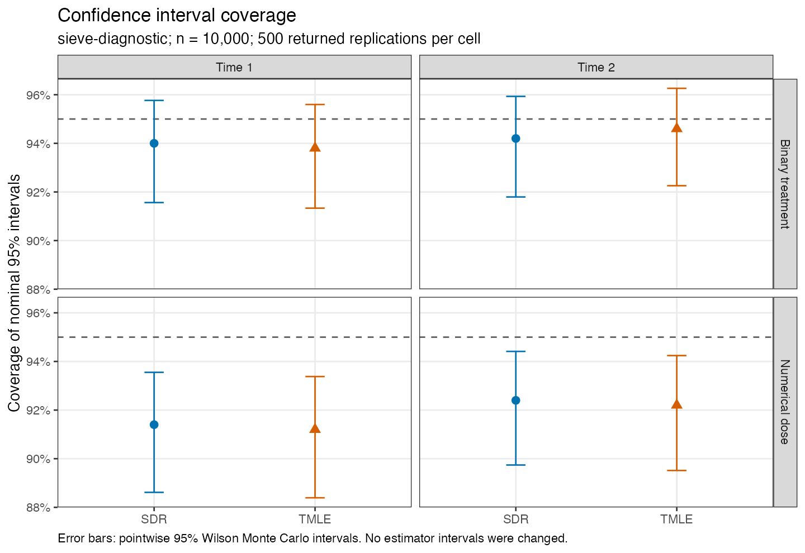
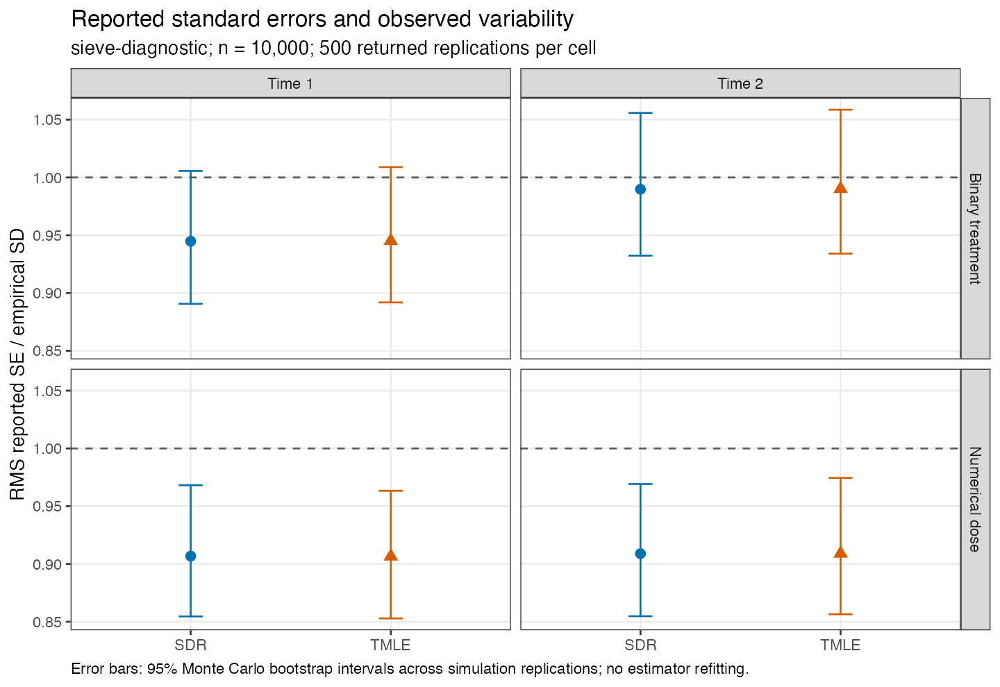

# Completed coverage precision diagnostic

All 1,000 datasets and 4,000 method/horizon estimates returned without failures
in [GitHub run 41488034067](https://github.com/idiazst/lmtp_selfcensor_sim/actions/runs/41488034067).
Each mechanism has 500 replications at n=10000. This is the separately labeled
single-sieve diagnostic with positive ridge .001, lmtp 1.6.0.9025 and cmbridge
0.3.0.9030, frozen at commit `bb8a0079f3339f4f73b5656e9ffd9c9cfec40a55`.
Every nuisance is estimated. This specification is not pooled with the primary
ensemble or any older source version.

| Mechanism | Horizon | SDR bias | TMLE bias | SDR coverage | TMLE coverage |
|---|---:|---:|---:|---:|---:|
| Binary | 1 | .000484 | .000498 | .940 | .938 |
| Binary | 2 | .000570 | .000612 | .942 | .946 |
| Numerical dose | 1 | .001303 | .001314 | .914 | .912 |
| Numerical dose | 2 | .001735 | .001738 | .924 | .922 |

The numerical-dose coverage shortfall exceeds pointwise Monte Carlo uncertainty:
all four upper 95% Wilson limits are below .95. The binary limits include .95.
Numerical-dose RMS reported SEs are about 9% below empirical SD at both horizons.
The Monte Carlo bootstrap intervals for their SE/SD ratios also exclude one.
Bias is small on the outcome scale, although the dose biases are about 2.1-2.2
Monte Carlo standard errors from zero. These results identify a calibration
problem in this diagnostic specification, without isolating its cause.

The internal variance assembly check passes within 1.1e-14. It verifies that
the reported variance is the sequential variance plus bridge variance and
twice their covariance; it does not establish repeated-sample calibration.

An independent analytical audit compares forward causal derivatives with
E[D * observed-law score] across 58 cell-specific law directions, both horizons,
and two finite-difference steps. All 232 comparisons pass with maximum error
3.2e-11. The score marginalizes unrecorded health values, and the reference
gradient is a function of observed data. Visit perturbations preserve the
treatment shadow exclusions. This validates the formulas on the tested finite
family, not the quality of finite-sample nuisance fits. See
[GRADIENT_VALIDATION.md](GRADIENT_VALIDATION.md) and its derivative tables.

The main full-ensemble study remains separate. The matched positive-ridge
sensitivity run is also separate: its 1e-5 ridge changes the bridge/adjoint
regularization only. The first 20 available binary pairs show a mean first-horizon
SE increase of .000339 (about 2.6%) and a mean estimate change of -.000162.
Their coverage comparison is too small to assess calibration; numerical-dose
pairs and the full 100-replication matched cells are still needed. No estimator
intervals have been rescaled and no failed seeds have been replaced.

`REPORT.md` and `summary.csv` contain the original reporting fields;
`INFERENCE.md` and `inference-diagnostics.csv` add Monte Carlo uncertainty;
`score-variance.csv` retains individual variance identities. The PDF and PNG
figures come from `plot-inference.R`; their calibration intervals resample
simulation replications only, with no estimator refitting. The full fitting
manifest is retained as `SPECIFICATION.txt`. Frozen study and package sources
and the complete GitHub artifacts allow reproduction.
