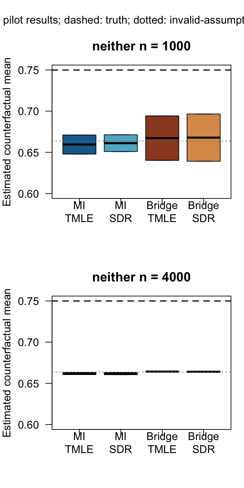
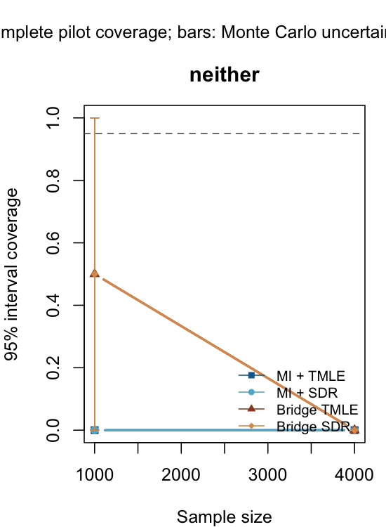

# Complete corrected MI + lmtp comparison (pilot)

4 of 4 datasets saved; 16 of 16 returned method estimates.

The MI arms run the exported standard lmtp_tmle and lmtp_sdr functions on each of 50 completed datasets, then pool estimates and complete-data EIF variances separately using Rubin's rules. R2 is excluded from completed-data analysis. Both arms use identical imputations and saved outer folds. The first three scenarios reuse the validated original estimates. The neither scenario uses newly fitted bridge estimates with identical settings.

Packages: cmbridge 0.3.0.9020, lmtp 1.6.0.9021, mice 3.19.0, from the verified original private library. Target E[Y2(1)] = 0.75.

| Scenario | n | Method | Successful / completed | Mean | Bias | MSE | RMSE | 95% coverage | Mean SE | Empirical SD |
|---|---:|---|---:|---:|---:|---:|---:|---:|---:|---:|
| neither | 1000 | MI + TMLE | 2 / 2 | 0.6595 | -0.0905 | 0.008327 | 0.0913 | 0.0% | 0.0268 | 0.0164 |
| neither | 1000 | MI + SDR | 2 / 2 | 0.6612 | -0.0888 | 0.007996 | 0.0894 | 0.0% | 0.0269 | 0.0144 |
| neither | 1000 | Bridge TMLE | 2 / 2 | 0.6673 | -0.0827 | 0.007576 | 0.0870 | 50.0% | 0.0338 | 0.0382 |
| neither | 1000 | Bridge SDR | 2 / 2 | 0.6679 | -0.0821 | 0.007567 | 0.0870 | 50.0% | 0.0338 | 0.0406 |
| neither | 4000 | MI + TMLE | 2 / 2 | 0.6619 | -0.0881 | 0.007769 | 0.0881 | 0.0% | 0.0140 | 0.0018 |
| neither | 4000 | MI + SDR | 2 / 2 | 0.6618 | -0.0882 | 0.007781 | 0.0882 | 0.0% | 0.0140 | 0.0018 |
| neither | 4000 | Bridge TMLE | 2 / 2 | 0.6642 | -0.0858 | 0.007357 | 0.0858 | 0.0% | 0.0173 | 0.0005 |
| neither | 4000 | Bridge SDR | 2 / 2 | 0.6641 | -0.0859 | 0.007382 | 0.0859 | 0.0% | 0.0173 | 0.0005 |

MAR only: MI targets 0.75; the violated shadow restriction implies bridge target 0.6126667. Shadow only: bridge targets 0.75; MAR imputation implies target 0.6140584. Both assumptions: both population functionals equal 0.75. Neither assumption: both population functionals equal 0.6637440. The causal estimand remains 0.75 in every scenario. Saturated model classes avoid additional functional-form restrictions; finite-sample estimation and regularization remain.

Coverage is among returned estimates. summary.csv also reports failures counted as noncovering, Monte Carlo errors, interval widths, and imputation Monte Carlo variability. The pilot is an implementation check, not a precise performance assessment.

MI diagnostics: 400 completed-data API calls; 0 failed calls; maximum imputation reconstruction error 0; maximum reconstructed EIF error 4.44e-16; 0 failed support assertions; 0 noninterior regression selections.

Bridge diagnostics retained: 0 conditional-moment candidate failures and 2 recorded Landweber iteration-limit stops. These did not necessarily prevent a returned final estimate and are not evidence that every candidate converged to tolerance.

The original MI + saturated-standardization arm is excluded from this corrected comparison; its output remains under mi-comparison-v1.

