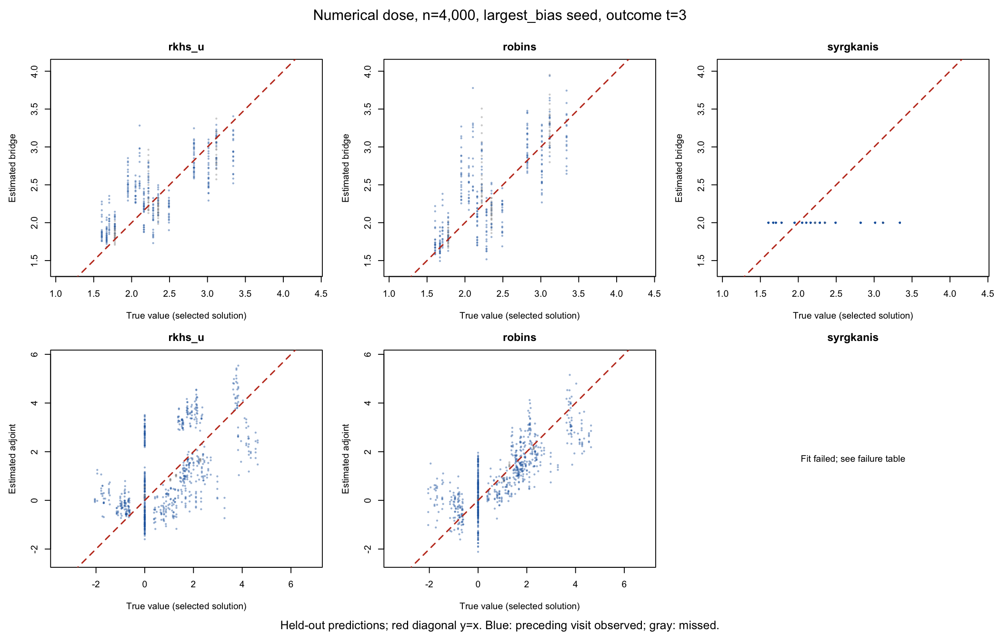
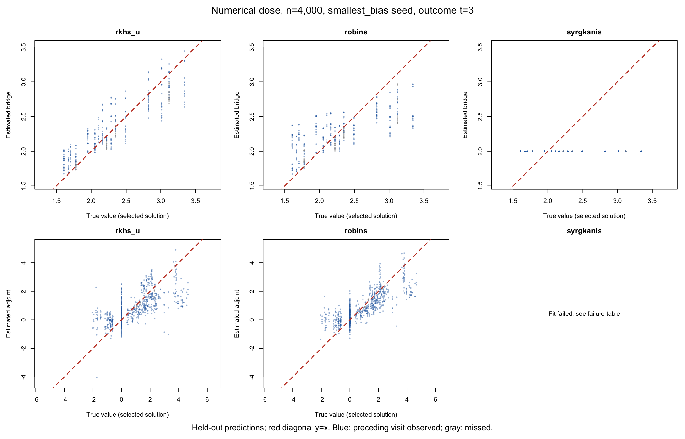
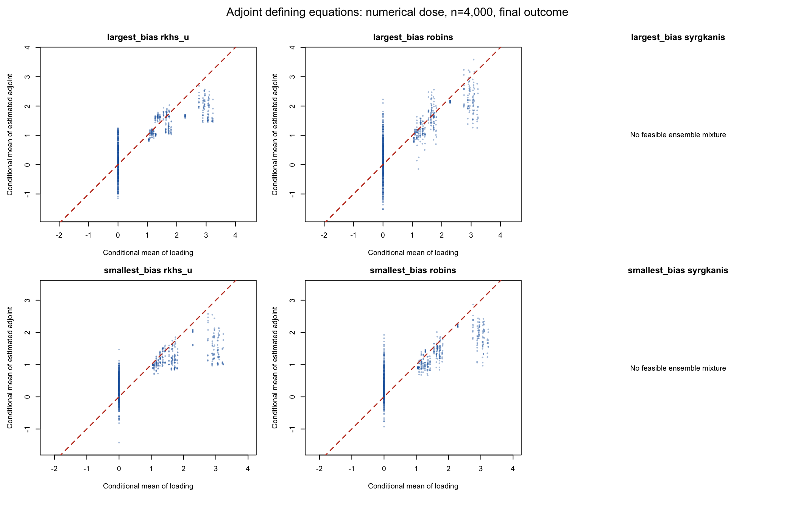

# Robins and Syrgkanis selection: numerical dose, n=4,000

Limited diagnostic of the two previously selected datasets, seeds 5203041 and 5203167. Both follow-ups and three saved outer folds are evaluated. This is not a 200-replication study and supplies no new SDR/TMLE estimates or confidence-interval coverage.

The frozen DGP, datasets, original outer/learner splits, bridge inverse-expit links, unrestricted adjoints and three candidate classes are retained. All three candidates now select their ridge or stopping iteration, so this changes previously fixed PMMR/Landweber controls as well as the criterion. The extra independent projection sample also reduces intermediate fitting sample sizes. The original RKHS U fits are included as a frozen baseline, not refitted.

Robins uses the debiased projected conditional-equation score on a separate validation sample. Syrgkanis calibrates the actual full-training fit with an empirical critic and a common multiplier-bootstrap noise envelope over the evaluated path. Its ensemble minimizes the second moment of the fitted mixture subject to held-out discrepancy. These are documented adaptations around our native objectives and penalties; the papers' full estimator guarantees are not claimed.

Projection ridge is selected by training-only leave-one-out CV on a positive extendable grid. No DGP truth enters either selector. As in the preceding isolated diagnostic, the adjoint loading uses exact treatment ratios; no sequential regressions are fitted. The true functions are used only for evaluation and satisfy the population equations. References can be nonunique.

## Final-outcome ensemble results

| Seed | Selector | Function | RMSE to reference | Equation RMSE | Completed folds |
|---|---|---|---:|---:|---:|
| 5203041 | robins | bridge | 0.31055 | 0.10450 | 3/3 |
| 5203041 | robins | adjoint | 0.59976 | 0.32538 | 3/3 |
| 5203041 | rkhs_u | bridge | 0.25521 | 0.09104 | 3/3 |
| 5203041 | rkhs_u | adjoint | 0.95432 | 0.44014 | 3/3 |
| 5203041 | syrgkanis | bridge | 0.49750 | 0.16993 | 3/3 |
| 5203167 | robins | bridge | 0.27953 | 0.09146 | 3/3 |
| 5203167 | robins | adjoint | 0.54610 | 0.27854 | 3/3 |
| 5203167 | rkhs_u | bridge | 0.16979 | 0.05998 | 3/3 |
| 5203167 | rkhs_u | adjoint | 0.70467 | 0.39176 | 3/3 |
| 5203167 | syrgkanis | bridge | 0.49750 | 0.16993 | 3/3 |

## Ensemble weights

| Seed | Selector | Function | Candidate | Mean weight | Completed folds |
|---|---|---|---|---:|---:|
| 5203041 | robins | bridge | sieve_md | 0.6667 | 3/3 |
| 5203041 | robins | bridge | landweber | 0.3333 | 3/3 |
| 5203041 | robins | bridge | pmmr | 0.0000 | 3/3 |
| 5203041 | robins | adjoint | sieve_md | 0.1421 | 3/3 |
| 5203041 | robins | adjoint | landweber | 0.0693 | 3/3 |
| 5203041 | robins | adjoint | pmmr | 0.7886 | 3/3 |
| 5203041 | rkhs_u | bridge | sieve_md | 0.3310 | 3/3 |
| 5203041 | rkhs_u | bridge | landweber | 0.3083 | 3/3 |
| 5203041 | rkhs_u | bridge | pmmr | 0.3607 | 3/3 |
| 5203041 | rkhs_u | adjoint | sieve_md | 0.2893 | 3/3 |
| 5203041 | rkhs_u | adjoint | landweber | 0.7107 | 3/3 |
| 5203041 | rkhs_u | adjoint | pmmr | 0.0000 | 3/3 |
| 5203041 | syrgkanis | bridge | sieve_md | 0.0000 | 3/3 |
| 5203041 | syrgkanis | bridge | landweber | 0.0000 | 3/3 |
| 5203041 | syrgkanis | bridge | pmmr | 1.0000 | 3/3 |
| 5203167 | robins | bridge | sieve_md | 0.6254 | 3/3 |
| 5203167 | robins | bridge | landweber | 0.2926 | 3/3 |
| 5203167 | robins | bridge | pmmr | 0.0820 | 3/3 |
| 5203167 | robins | adjoint | sieve_md | 0.3957 | 3/3 |
| 5203167 | robins | adjoint | landweber | 0.0070 | 3/3 |
| 5203167 | robins | adjoint | pmmr | 0.5973 | 3/3 |
| 5203167 | rkhs_u | bridge | sieve_md | 0.3383 | 3/3 |
| 5203167 | rkhs_u | bridge | landweber | 0.3250 | 3/3 |
| 5203167 | rkhs_u | bridge | pmmr | 0.3367 | 3/3 |
| 5203167 | rkhs_u | adjoint | sieve_md | 0.5353 | 3/3 |
| 5203167 | rkhs_u | adjoint | landweber | 0.3803 | 3/3 |
| 5203167 | rkhs_u | adjoint | pmmr | 0.0844 | 3/3 |
| 5203167 | syrgkanis | bridge | sieve_md | 0.0000 | 3/3 |
| 5203167 | syrgkanis | bridge | landweber | 0.0000 | 3/3 |
| 5203167 | syrgkanis | bridge | pmmr | 1.0000 | 3/3 |

## Failures and verification

18 recorded outer/candidate failures. All failures remain in failures.csv and the saved checkpoints; failed fits are not reported as successful coverage results.

Successful fits have disjoint fitting/projection/scoring samples for Robins validation, unchanged outer exclusion, replayed selection Grams, positive selected penalties, and feasible discrepancy mixtures. See checks.csv, penalties.csv, metrics.csv, weight-summary.csv and compressed out-of-sample predictions. Individual candidate plots and both follow-ups accompany the report.

Package branch: robins-syrgkanis-selection. Simulation branch: robins-syrgkanis-n4000. Full study pins and results are unchanged.

## Interpretation

The Robins adapter is not a uniform improvement in these two datasets. Compare bridge error, adjoint equation error and the preceding-visit-observed subset in summary.csv. Its extra independent projection sample reduces intermediate fit sizes, so this is not an isolated change of loss with identical fitted candidates.

The discrepancy adapter admits very strong bridge penalties. PMMR receives all bridge ensemble weight at the final outcome and approaches beta=2: a ridge on its inverse-expit linear predictor sends that predictor toward zero, whose inverse-expit is two. This is a consequence of retaining the native link-scale penalty, not the function-scale Tikhonov penalty in the cited paper. The bootstrap threshold also reflects sparse empirical moment categories; it must not be treated as a proven complexity bound.

The discrepancy adjoint ensemble constraint is infeasible in the recorded failed folds. Those fits are not replaced by another selector and their thresholds are not inflated. The individually tuned candidate functions are still evaluated and plotted. The failed ensemble panels are deliberately blank and labeled.

These results do not establish that either published method fails: they evaluate the documented adaptations to our native learners. They also do not establish repaired SDR/TMLE coverage.

Individual final-outcome candidates: [Robins, largest error](largest_bias-t3-robins-candidates-y-equals-x.png), [Syrgkanis, largest error](largest_bias-t3-syrgkanis-candidates-y-equals-x.png), [Robins, smallest error](smallest_bias-t3-robins-candidates-y-equals-x.png), [Syrgkanis, smallest error](smallest_bias-t3-syrgkanis-candidates-y-equals-x.png).

Package source: [7a180142](https://github.com/idiazst/cmbridge/commit/7a180142bdb6f8a2d7b2c8892e535206a0e49727). [Package CI passed](https://github.com/idiazst/cmbridge/actions/runs/38192555221). Local unit checks passed 532 assertions; package check had no errors or warnings and the existing closure-binding NOTE.

Measured fitting interval: October 11, 2026, 21:35:25–21:42:32 EDT (7.12 minutes), using six independent local R processes. Earlier preflight/calibration attempts and OpenMP failures are retained locally under .runtime/adaptive-pilot-v1 and .runtime/adaptive-attempt-v2. They are not merged into these results.
