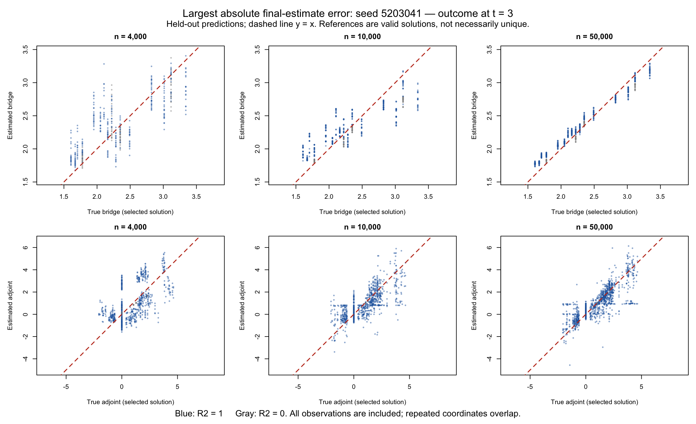
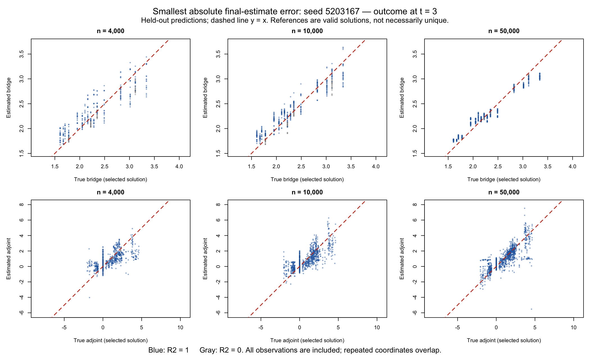
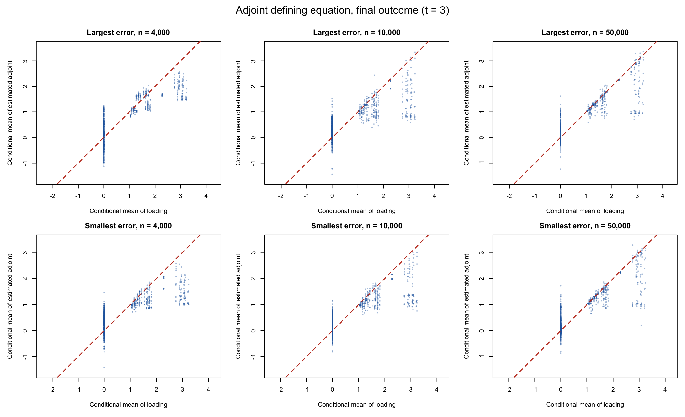

# Numerical-dose bridge and adjoint diagnostic

The lowest longitudinal coverage was 82.4% for the SDR final outcome at n=1,000. Select the largest and smallest absolute realized errors among its 199 successful n=4,000 replications, then generate one dataset at each of n=4,000, 10,000 and 50,000 from each selected seed.

These are six selected-data diagnostics, not a new coverage or convergence study. Each sample size resets the same data seed; datasets are not required to be nested. The original n=4,000 outer/learner splits are reused. Three outer folds and the original training-only penalty/ensemble folds are retained. Predictions in the function plots are held out. Model libraries, positive-penalty CV, links, kernels and failure rules match the frozen study. No package was edited.

Only bridge and adjoint ensembles are fitted, for both follow-ups. For this isolated diagnostic, the adjoint loading uses exact treatment ratios calculated from the DGP. There are no treatment/outcome-regression fits and no new SDR/TMLE parameter estimates. This differs from the full study's estimated treatment-ratio loading.

The bridge reference is the inverse measurement probability, a valid solution contained in the bridge class. It remains a valid solution at histories with a missed visit; the older constant reference there is another solution. The adjoint reference is the previously specified minimum-Euclidean-norm solution. Both satisfy the exact population equations before any model is fitted. Adjoint solutions can be nonunique even when the earlier visit was observed. Distance from this reference alone is not a failure criterion; exact population conditional-equation errors are also reported.

| Selected n=4,000 dataset | Seed | Original SDR estimate | Absolute error |
|---|---:|---:|---:|
| largest_bias | 5203041 | 0.581254460 | 0.052369586 |
| smallest_bias | 5203167 | 0.633673527 | 0.000049481 |

## Final-outcome checks

RMSE to reference and defining-equation RMSE use the exact population support and probabilities, averaged over the three outer fits. Maximum equation error includes every positive-probability history. Internal candidate failures are retained.

| Selected seed | n | Function | RMSE to selected solution | Equation RMSE | Max equation error | Candidate failures |
|---|---:|---|---:|---:|---:|---:|
| 5203041 | 10000 | bridge | 0.20556 | 0.06637 | 0.25074 | 0 |
| 5203041 | 10000 | adjoint | 0.59680 | 0.27196 | 2.51160 | 0 |
| 5203041 | 4000 | bridge | 0.25521 | 0.09104 | 0.43282 | 0 |
| 5203041 | 4000 | adjoint | 0.95432 | 0.44014 | 1.77437 | 0 |
| 5203041 | 50000 | bridge | 0.08765 | 0.02800 | 0.11357 | 0 |
| 5203041 | 50000 | adjoint | 0.33212 | 0.11672 | 2.26443 | 0 |
| 5203167 | 10000 | bridge | 0.12855 | 0.04647 | 0.19706 | 0 |
| 5203167 | 10000 | adjoint | 0.57355 | 0.25856 | 2.48284 | 0 |
| 5203167 | 4000 | bridge | 0.16979 | 0.05998 | 0.24091 | 0 |
| 5203167 | 4000 | adjoint | 0.70467 | 0.39176 | 2.23114 | 0 |
| 5203167 | 50000 | bridge | 0.08922 | 0.02991 | 0.11371 | 0 |
| 5203167 | 50000 | adjoint | 0.34540 | 0.12201 | 2.88400 | 0 |

First-follow-up plots: [largest error](largest_bias-time2-y-equals-x.png), [smallest error](smallest_bias-time2-y-equals-x.png). Complete weights, failures, fold-specific metrics, population predictions and equations accompany this report. Compressed held-out predictions retain every plotted row.

## Interpretation and verification

Both selected seeds show improved final-outcome bridge recovery as n increases. Its population-weighted distance from the selected solution falls from 0.255 to 0.088 for the largest-error seed and from 0.170 to 0.089 for the smallest-error seed between n=4,000 and n=50,000.

The final-outcome adjoint's population conditional-equation RMSE also improves: 0.440 to 0.117 and 0.392 to 0.122, respectively. Some equations remain substantially wrong at n=50,000: maximum absolute errors are 2.264 and 2.884. These discrepancies cannot be explained solely by nonuniqueness, because every valid solution must satisfy those equations. This experiment does not establish their cause or resolve the full study's undercoverage.

At n=50,000, histories with an adjoint conditional-equation error larger than 0.5 account for 0.95–1.52% of the measured population probability in the six outer fits. These histories contribute 42–64% of the squared equation error. The large discrepancies are therefore concentrated in relatively uncommon histories, but are retained in the plots and maximum-error summary. See [fold-specific values](adjoint-large-equation-errors.csv).

The [support audit](sieve-support-by-fold.csv) records population input categories absent from each sieve training sample. For the adjoint at n=50,000, the mean absent-category probability is 0.34% for the largest-error seed and 0.41% for the smallest-error seed. This describes incomplete training support; it does not prove that it explains all remaining equation error. The bridge's global main-effect terms continue to predict when a joint category was absent.

The original smallest-error dataset does not demonstrate that its nuisance fits were accurate: its mean sequential EIF component was -0.0132631 and its mean bridge/adjoint component was +0.0133125. Their sum was almost zero. These are the saved full-study contributions; this diagnostic does not refit that estimator.

[Verification](VERIFICATION.txt) confirms shared data draws, unchanged fitting sources, outer-fold separation, complete held-out predictions and positive CV grids with interior choices. All 72 ensembles returned with no candidate failures. These are integrity checks, not a claim that the statistical equation errors vanish. [Penalty CV](penalty-cv.csv), [warnings](warnings.csv), and [checkpoint hashes](checkpoint-hashes.csv) preserve the numerical evidence.
