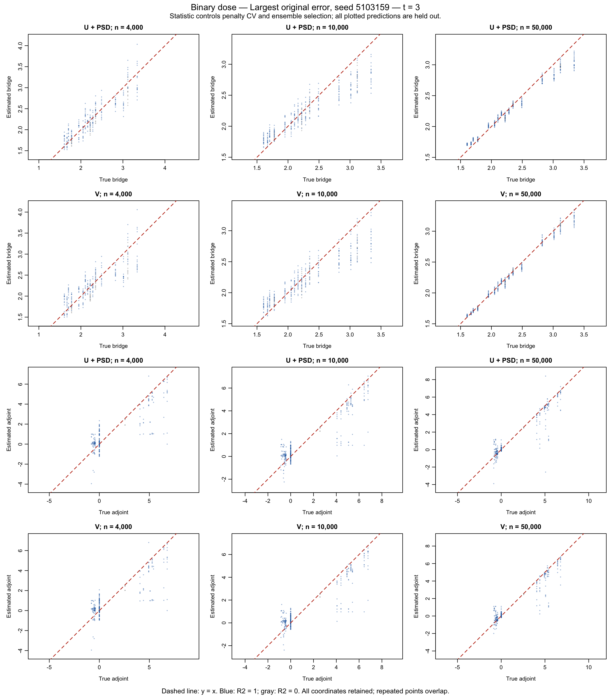
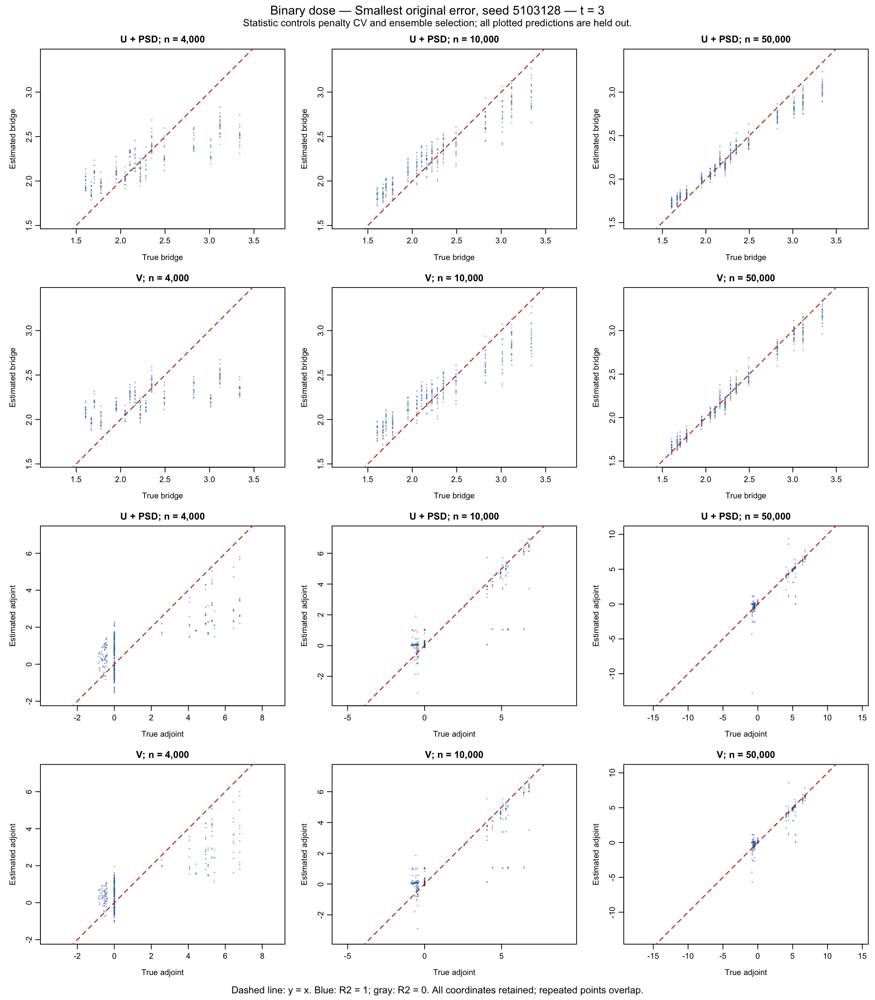
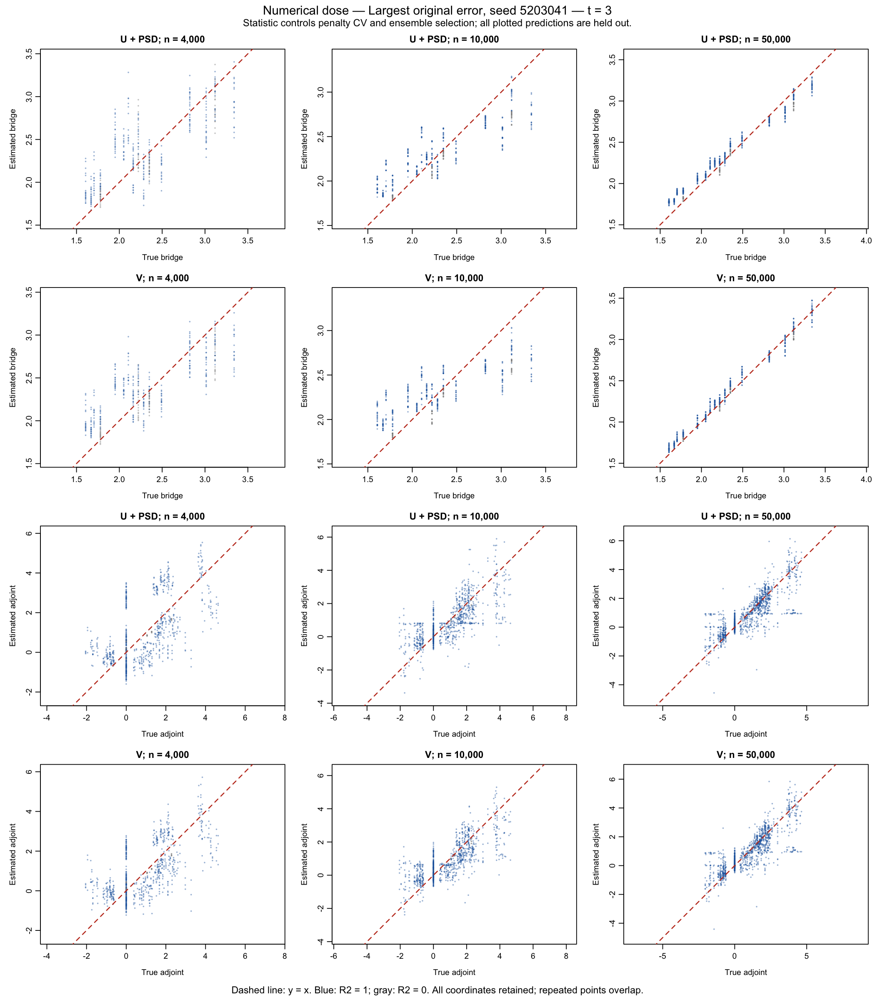
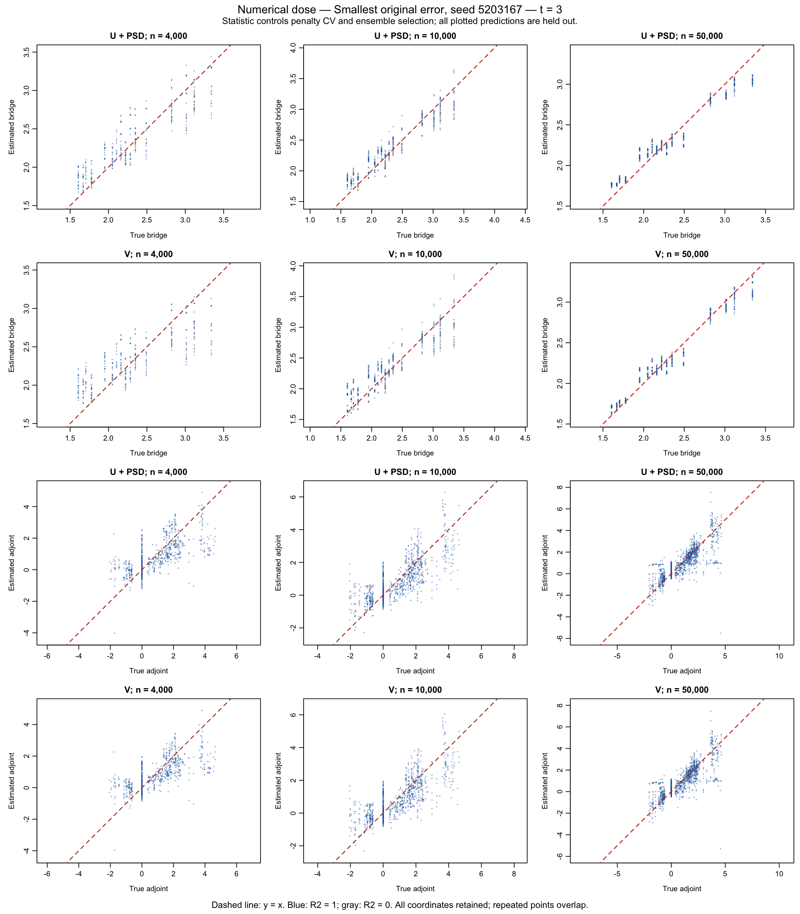

# U versus V for the bridge and adjoint ensembles

**Completed limited diagnostic.**

Use binary and numerical-dose longitudinal DGPs with missingness at both follow-ups. For each DGP, select the largest and smallest absolute realized final-outcome SDR errors among the successful n=4,000, correctly specified full-study datasets. Reset each selected seed at n=4,000, 10,000 and 50,000. These are 12 selected datasets, not 200-replication coverage results.

Only bridge and adjoint ensembles are fitted. The three candidates, inverse-expit bridge parameterization, unrestricted adjoint, positive extendable penalty grid and three shared outer/learner folds are unchanged. The isolated adjoint loading uses exact DGP treatment ratios, as in the preceding diagnostic; there are no treatment/outcome-regression fits, new SDR/TMLE parameter estimates or Gaussian mean updates.

In these frozen libraries, sieve_md supplies the positive penalty-CV grid. Landweber and PMMR retain their original fixed controls. Changing the statistic therefore changes sieve penalty selection and all ensemble scores, while preserving the other candidates' controls.

## What is compared

1. **Refits:** `statistic="u"` versus `statistic="v"` controls both training-only candidate penalty CV and ensemble selection. U retains the existing PSD projection; V uses its naturally PSD matrix directly. Each candidate is refit inside its outer training sample. Numerical-dose U fits reuse the previous frozen checkpoints, with hashes and provenance retained; fresh fits use cmbridge 0.3.0.9022.
2. **Identical candidates:** rescore the saved U-tuned candidates with projected U, unprojected U, and V. Predictions, penalties, folds and training-derived kernel specifications are identical. Only the ensemble weights change. Unprojected U is minimized globally over the simplex by enumerating its faces; this diagnostic does not change the package's default optimizer.
3. **Truth included as a diagnostic candidate:** compare empirical selection with exact population selection. Known functions are used only for this loss check, never for tuning the fitted candidates.

Every kernel scale, bandwidth and Nyström center comes from its corresponding original training sample. All plotted rows are excluded from the fitted outer training sample. At n=4,000 the original full-study outer and learner assignments are reused. Identical seeds across sample sizes do not imply nested samples, because the DGP draws variables in blocks.

Both true reference functions solve their exact population moment equations. The bridge reference is the inverse measurement probability; alternative bridge solutions can exist after an earlier missed visit. Adjoint solutions may also be nonunique. Function scatter alone is insufficient to diagnose failure; the defining conditional equations are also evaluated.

## Selected seeds

| DGP | Original error selection | Seed | Original SDR estimate | True parameter | Absolute error |
|---|---|---:|---:|---:|---:|
| Binary dose | Largest original error | 5103159 | 0.893011 | 0.649747 | 0.243263 |
| Binary dose | Smallest original error | 5103128 | 0.650085 | 0.649747 | 0.000337 |
| Numerical dose | Largest original error | 5203041 | 0.581254 | 0.633624 | 0.052370 |
| Numerical dose | Smallest original error | 5203167 | 0.633674 | 0.633624 | 0.000049 |

## Final-outcome refits

Each number integrates over the exact finite DGP population and averages squared errors over the three outer fits before taking the square root. Bridge RMSE compares the fitted function with the selected true solution. Adjoint equation RMSE measures violation of its defining conditional equation.

| DGP | Seed | n | Bridge RMSE: U | Bridge RMSE: V | Adjoint equation RMSE: U | Adjoint equation RMSE: V |
|---|---:|---:|---:|---:|---:|---:|
| Binary dose | 5103159 | 4000 | 0.16570 | 0.21209 | 0.53775 | 0.51367 |
| Binary dose | 5103159 | 10000 | 0.17091 | 0.17677 | 0.27012 | 0.25339 |
| Binary dose | 5103159 | 50000 | 0.07931 | 0.04342 | 0.12434 | 0.12404 |
| Binary dose | 5103128 | 4000 | 0.26856 | 0.32122 | 0.75437 | 0.58014 |
| Binary dose | 5103128 | 10000 | 0.16073 | 0.17959 | 0.20613 | 0.21614 |
| Binary dose | 5103128 | 50000 | 0.09410 | 0.06210 | 0.13775 | 0.10517 |
| Numerical dose | 5203041 | 4000 | 0.25521 | 0.24756 | 0.44014 | 0.36796 |
| Numerical dose | 5203041 | 10000 | 0.20556 | 0.24676 | 0.27196 | 0.26954 |
| Numerical dose | 5203041 | 50000 | 0.08765 | 0.05731 | 0.11672 | 0.11860 |
| Numerical dose | 5203167 | 4000 | 0.16979 | 0.23509 | 0.39176 | 0.38047 |
| Numerical dose | 5203167 | 10000 | 0.12855 | 0.15614 | 0.25856 | 0.25743 |
| Numerical dose | 5203167 | 50000 | 0.08922 | 0.06788 | 0.12201 | 0.12438 |

## Exact population RKHS loss with identical candidates

All losses below are the full-RBF population loss multiplied by one million. The same kernel is used for all mixtures within a comparison. The population loss of the true function is zero. These are evaluation losses, not the scores minimized in the sample.

| DGP | Seed | n | Function | U + PSD | Raw U | V |
|---|---:|---:|---|---:|---:|---:|
| Binary dose | 5103159 | 4000 | adjoint | 995.73 | 995.73 | 776.76 |
| Binary dose | 5103159 | 4000 | bridge | 299.67 | 335.03 | 329.21 |
| Binary dose | 5103159 | 10000 | adjoint | 216.92 | 216.92 | 185.13 |
| Binary dose | 5103159 | 10000 | bridge | 134.05 | 128.03 | 137.67 |
| Binary dose | 5103159 | 50000 | adjoint | 46.37 | 46.36 | 46.87 |
| Binary dose | 5103159 | 50000 | bridge | 59.36 | 51.43 | 51.79 |
| Binary dose | 5103128 | 4000 | adjoint | 1981.85 | 1981.85 | 1274.94 |
| Binary dose | 5103128 | 4000 | bridge | 264.70 | 298.15 | 307.52 |
| Binary dose | 5103128 | 10000 | adjoint | 71.59 | 67.93 | 81.87 |
| Binary dose | 5103128 | 10000 | bridge | 414.36 | 398.43 | 414.69 |
| Binary dose | 5103128 | 50000 | adjoint | 17.30 | 17.43 | 18.37 |
| Binary dose | 5103128 | 50000 | bridge | 19.26 | 12.38 | 12.75 |
| Numerical dose | 5203041 | 4000 | adjoint | 949.11 | 958.27 | 631.86 |
| Numerical dose | 5203041 | 4000 | bridge | 206.70 | 216.91 | 189.63 |
| Numerical dose | 5203041 | 10000 | adjoint | 389.54 | 389.54 | 356.39 |
| Numerical dose | 5203041 | 10000 | bridge | 147.94 | 156.96 | 169.01 |
| Numerical dose | 5203041 | 50000 | adjoint | 17.27 | 17.27 | 19.75 |
| Numerical dose | 5203041 | 50000 | bridge | 94.46 | 92.18 | 91.71 |
| Numerical dose | 5203167 | 4000 | adjoint | 928.33 | 932.11 | 899.77 |
| Numerical dose | 5203167 | 4000 | bridge | 520.89 | 561.93 | 586.83 |
| Numerical dose | 5203167 | 10000 | adjoint | 427.09 | 426.77 | 385.41 |
| Numerical dose | 5203167 | 10000 | bridge | 98.61 | 100.97 | 104.01 |
| Numerical dose | 5203167 | 50000 | adjoint | 26.38 | 26.38 | 30.85 |
| Numerical dose | 5203167 | 50000 | bridge | 19.86 | 14.52 | 15.22 |

## Interpretation

V has lower final-outcome population RKHS loss in 12 of 24 refit comparisons. With identical U-tuned candidates, V improves on projected U in 12 of 24 comparisons; unprojected U improves on projected U in 9 of 24. Counts span both functions, both seeds and both DGPs. They describe these selected datasets and are not evidence of a universal ordering or repaired confidence-interval coverage.

These improvement counts exclude numerical ties: a decrease must exceed 1e-12 plus 1e-8 times the baseline loss. Complete unrounded losses accompany the report.

At n=4,000, V reduces bridge function RMSE in 1 of 4 selected datasets and adjoint equation RMSE in 4 of 4. At n=50,000, V reduces bridge function RMSE in 4 of 4. Thus changing the statistic is not a uniform improvement, especially for smaller-sample bridge fits.

For the n=50,000 adjoints, using V weights on identical U-tuned candidates increases population RKHS loss in 4 of 4 datasets. Any improvement from a complete V refit must therefore be distinguished from changes in penalty selection. Neither comparison eliminates the observed adjoint equation errors or establishes asymptotic inconsistency.

U estimates the squared population moment without self-products but can be negative. PSD projection changes that criterion. V retains self-products and is naturally PSD, while adding a candidate-dependent finite-sample bias. The identical-candidate comparison isolates weight selection; the refit comparison includes any change in the selected candidate penalties.

Additional optimizer check: 4 of 144 saved U-fit score matrices have negative curvature along changes in weights that preserve their sum, using a 1e-12 numerical tolerance. A negative eigenvalue of the full score matrix does not by itself imply nonconvexity on the simplex. This distinguishes the original unrestricted matrix from the actual feasible weight problem; complete eigenvalue checks are retained.

At the final outcome (t=3), none of the 72 U-fit matrices has negative curvature on the simplex. The four exceptions above are numerical-dose adjoint fits at t=2. A future raw-U implementation could check this restricted curvature directly; here raw-U weighting remains an evaluation-only comparison.

## Results pooled over the two selected seeds

RMSE here averages squared population errors across both selected datasets and their three outer fits before taking the square root. This summarizes the preceding per-seed table; it is not a Monte Carlo coverage estimate.

| DGP | n | Bridge RMSE: U | Bridge RMSE: V | Adjoint equation RMSE: U | Adjoint equation RMSE: V |
|---|---:|---:|---:|---:|---:|
| Binary dose | 4000 | 0.22313 | 0.27218 | 0.65507 | 0.54792 |
| Binary dose | 10000 | 0.16590 | 0.17819 | 0.24026 | 0.23550 |
| Binary dose | 50000 | 0.08702 | 0.05358 | 0.13122 | 0.11499 |
| Numerical dose | 4000 | 0.21675 | 0.24140 | 0.41665 | 0.37426 |
| Numerical dose | 10000 | 0.17144 | 0.20648 | 0.26535 | 0.26356 |
| Numerical dose | 50000 | 0.08844 | 0.06282 | 0.11939 | 0.12152 |

## Function plots

### Binary dose: Largest original error



[Identical-candidate plot](binary_longitudinal-largest_bias-t3-fixed-y-equals-x.png)

[Adjoint defining-equation plot](binary_longitudinal-largest_bias-adjoint-equations.png)

### Binary dose: Smallest original error



[Identical-candidate plot](binary_longitudinal-smallest_bias-t3-fixed-y-equals-x.png)

[Adjoint defining-equation plot](binary_longitudinal-smallest_bias-adjoint-equations.png)

### Numerical dose: Largest original error



[Identical-candidate plot](discrete_dose-largest_bias-t3-fixed-y-equals-x.png)

[Adjoint defining-equation plot](discrete_dose-largest_bias-adjoint-equations.png)

### Numerical dose: Smallest original error



[Identical-candidate plot](discrete_dose-smallest_bias-t3-fixed-y-equals-x.png)

[Adjoint defining-equation plot](discrete_dose-smallest_bias-adjoint-equations.png)

## Verification and complete outputs

CV Gram replay agrees within 2.602e-18. True population RKHS losses are at most 4.380e-31; true conditional weighted moments are at most 2.223e-16. Candidate and outer-fit failures remain in the failure table; none are silently discarded.

[All sizes and follow-ups](summary.csv), [pooled sample-size comparison](sample-size-comparison.csv), [mean ensemble weights](weight-summary.csv), [candidate losses](candidate_losses.csv), [truth-augmented selection](augmented-summary.csv), [penalty-CV records](tuning.csv), [penalty-grid boundary attempts](penalty_boundaries.csv), [failures](failures.csv), [warnings](warning_rows.csv), [checkpoint verification](checks.csv), [all figure paths](figures.csv), and [held-out prediction rows](out-of-sample-predictions.csv.gz).

The opt-in API is `fit_bridge_ensemble(..., statistic = "v")` or `fit_adjoint_ensemble(..., statistic = "v")`. The default remains `statistic = "u"`. Package commit [8d820306](https://github.com/idiazst/cmbridge/commit/8d8203061fcb421a070b9ec50874e51d7409ea0b) passed [GitHub package and recovery validations](https://github.com/idiazst/cmbridge/actions/runs/38185965634).

Model checkpoints are retained locally and ignored by Git. The original completed-study runtime, source pins and checkpoints are unchanged. The fitting manifest and separate postprocessing hashes identify the code used.

Run from the simulation repository root after installing cmbridge 0.3.0.9022 into `.runtime/statistic-library`:

```sh
DIAGNOSTIC_WORKERS=6 Rscript studies/longitudinal/diagnostics/run_statistic_comparison.R
Rscript studies/longitudinal/diagnostics/compare_statistic_fits.R
Rscript studies/longitudinal/diagnostics/report_statistic_comparison.R
```

Measured fitting wall time: 26.80 minutes using 6 local workers, with 108 fresh bridge/adjoint fit pairs and 36 reused pairs. All 144 planned pairs completed. Runtime details are in [runtime.csv](runtime.csv).
