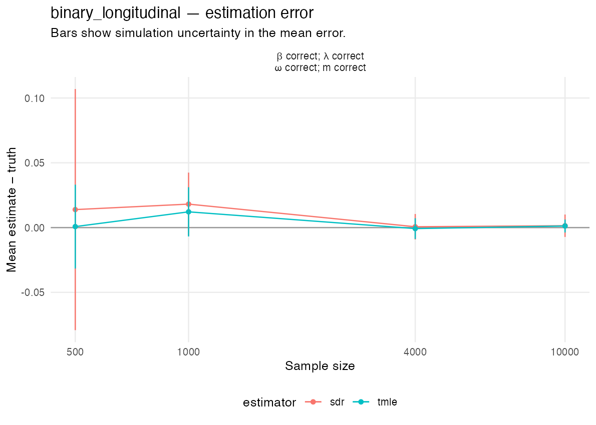
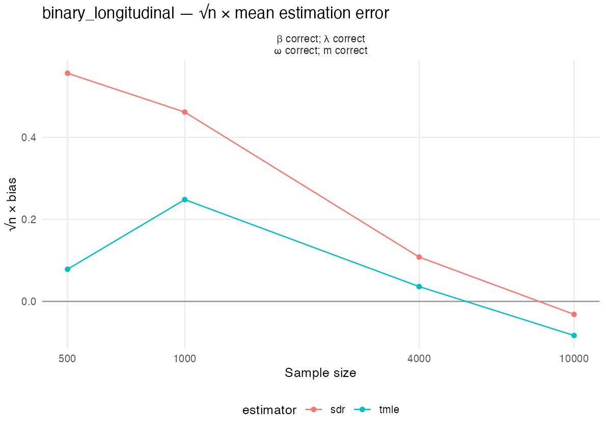
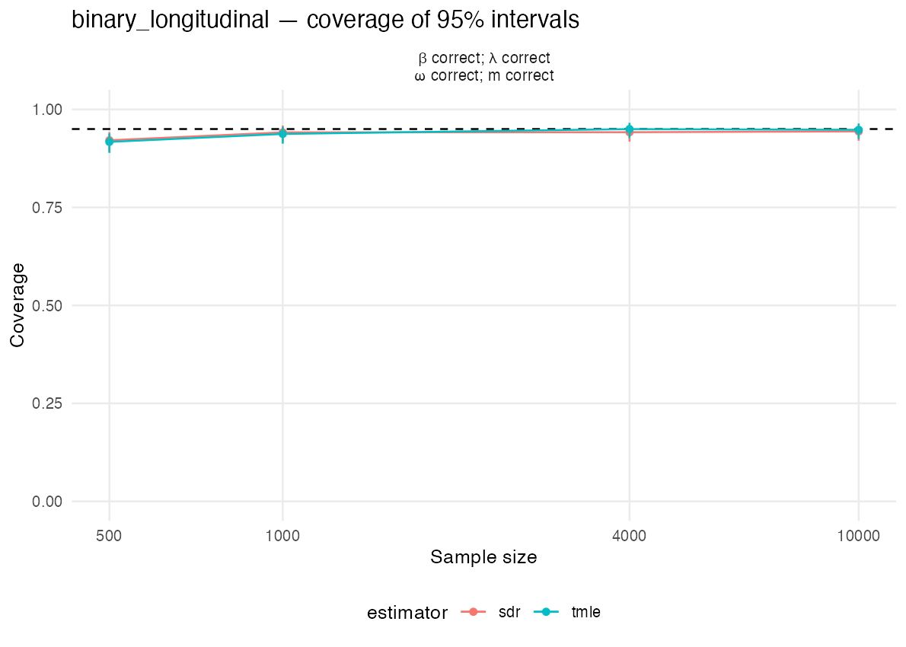
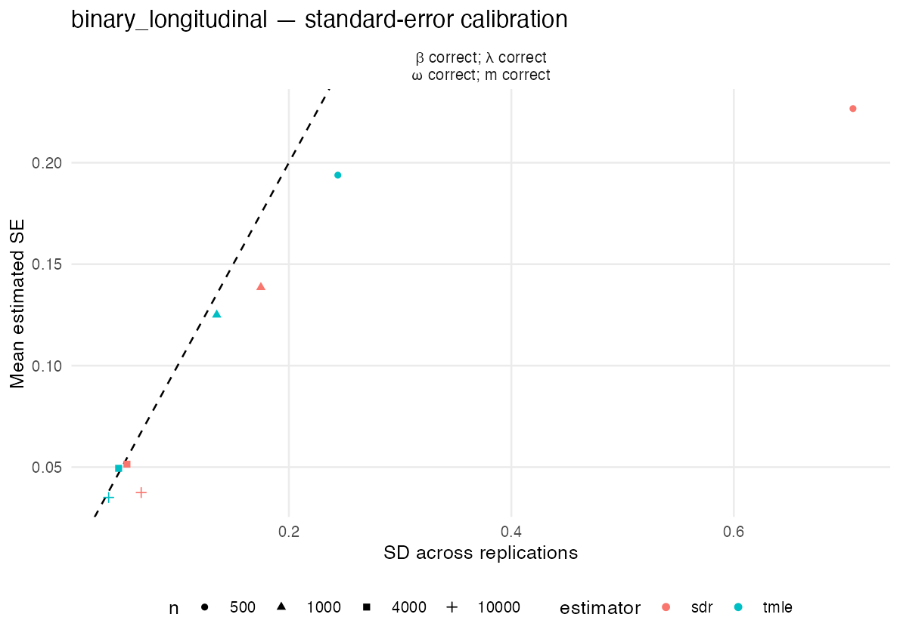
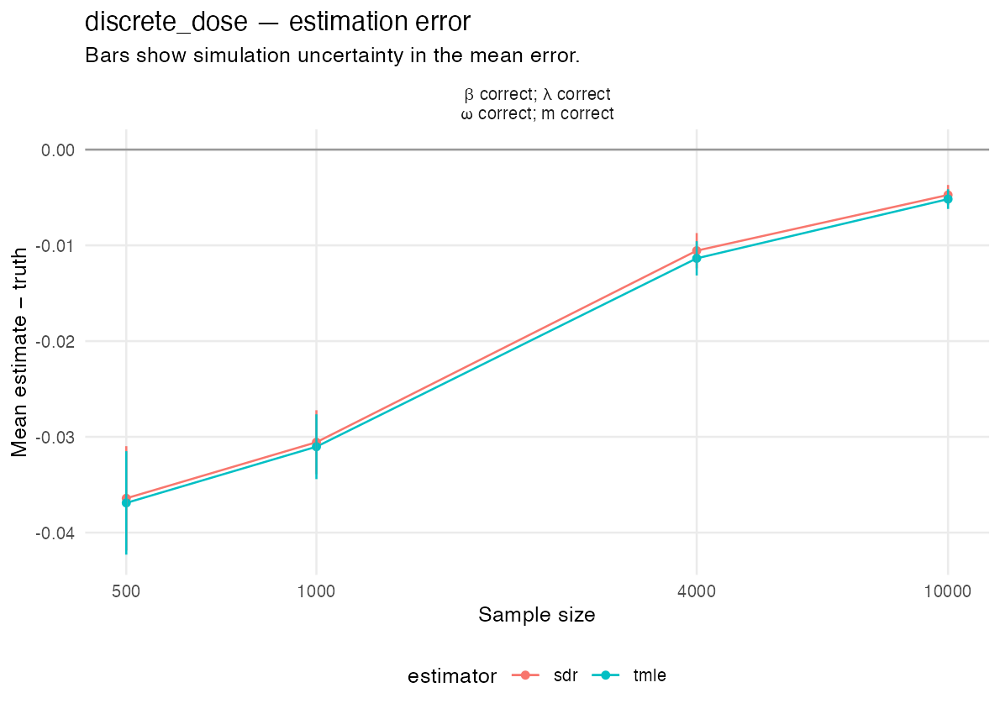
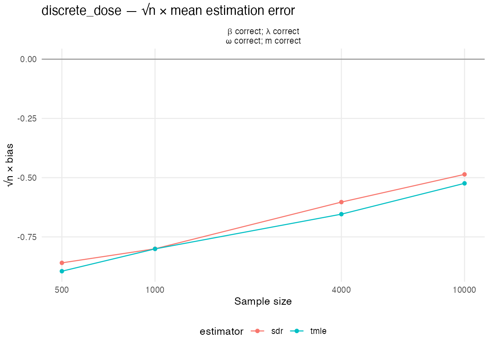
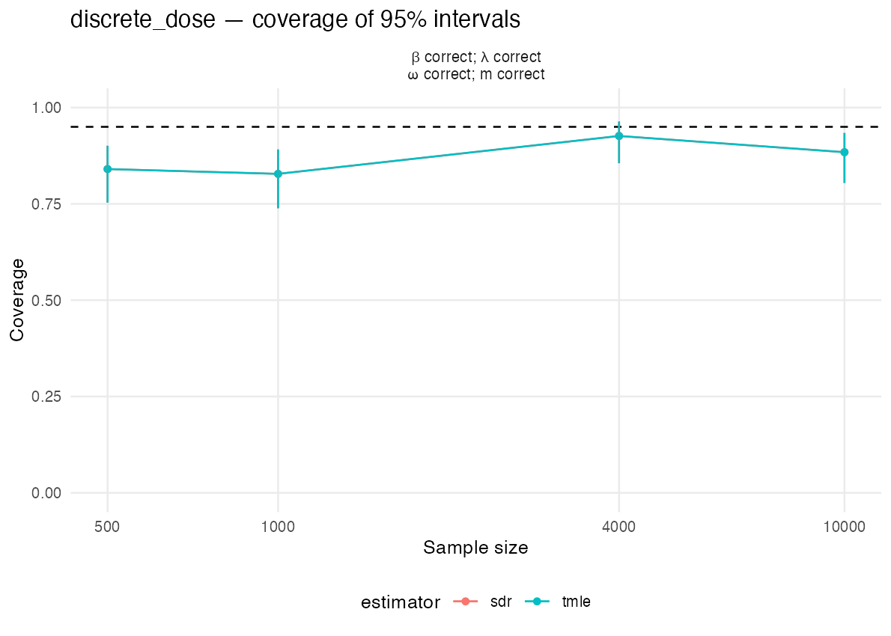
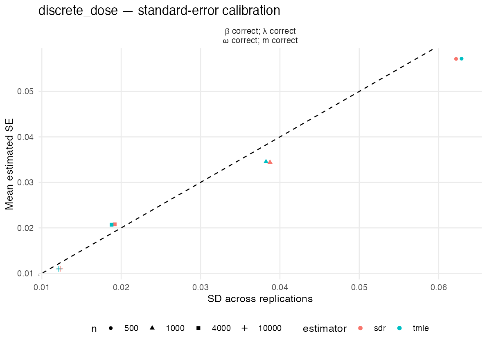
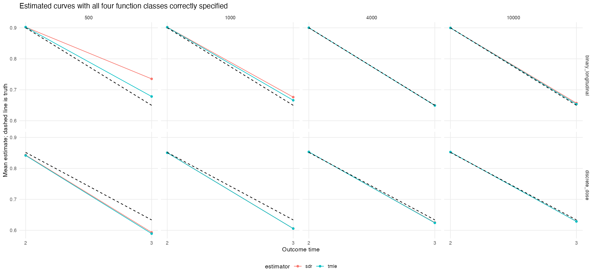

# Observed-history simulation: 500 replications

**PRELIMINARY: 1408 of 4,000 datasets have been processed.**

Checkpoint snapshot collected October 14, 2026, at approximately 20:55 EDT: 176 datasets per mechanism/sample-size setting, with 170–176 returned estimators. Fifteen datasets have recorded estimator failures; they remain counted and are not replaced.

Binary treatment and numerical dose 0–3 each use n = 500, 1,000, 4,000 and 10,000, with 500 datasets per setting. Both SDR and logistic TMLE use the one-step bridge/adjoint correction, shared training-only splits and the original positive penalty CV. The U-statistic ensemble Gram is projected to PSD. This is the original correctly specified full-study configuration; no experimental penalty rules, known-function estimators, zero-penalty runs or Gaussian mean updates are included.

The numerical package sources are the original frozen full-study archives: cmbridge 0.3.0.9020 and lmtp 1.6.0.9021. Hashes are verified before use. Seeds for the original sample sizes and first 200 replications retain their original mapping; all fits in this rerun are computed afresh on GitHub. References are used only for evaluation, never fitting or penalty selection.

## Newer t=3 Monte Carlo variance diagnosis

[The requested variance diagnosis](../variance-t3/REPORT.md) uses a newer snapshot: **3,576 checkpoints, 447 datasets per setting**, with failed fits retained and successful-fit denominators stated. It replaces each reported SE by the estimator's SD across Monte Carlo runs, leaving its estimate unchanged, and separately evaluates mean bias. Numerical-dose coverage improves but remains low at n=1,000 and n=4,000; variance estimation alone is insufficient. At n=1,000, Monte Carlo-SD coverage is 85.6%/86.0% for SDR/TMLE and becomes 95.9%/96.4% after subtracting mean bias. Full calculations, individual recomputed intervals, uncertainty, graphs and verification are linked in that diagnosis. **The older general tables below still use the 1,408-checkpoint snapshot.**

## Estimates and confidence intervals

Coverage below uses returned estimators as its denominator. Failed estimators, pending datasets, and coverage counting failures as producing no interval are also reported. At 500 successful replications, the simulation standard error of 95% coverage is about one percentage point. A partially completed subset may depend on fitting difficulty; it is not a final coverage study.

### Outcome at time 3

| Treatment | n | Estimator | Returned | Failed | Pending | Truth | Mean | Bias | RMSE | SD | MeanSE | Coverage | MCinterval |
| --- | --- | --- | --- | --- | --- | --- | --- | --- | --- | --- | --- | --- | --- |
| Binary treatment |   500 | SDR | 170 | 6 | 324 | 0.64975 | 0.66364 | 0.01389 | 0.61719 | 0.61886 | 0.23804 | 92.4% | [87.4%, 95.5%] |
| Binary treatment |   500 | TMLE | 170 | 6 | 324 | 0.64975 | 0.65051 | 0.00077 | 0.21457 | 0.21520 | 0.18870 | 92.9% | [88.1%, 95.9%] |
| Binary treatment |  1000 | SDR | 175 | 1 | 324 | 0.64975 | 0.66786 | 0.01811 | 0.16460 | 0.16407 | 0.13184 | 95.4% | [91.2%, 97.7%] |
| Binary treatment |  1000 | TMLE | 175 | 1 | 324 | 0.64975 | 0.66190 | 0.01216 | 0.12844 | 0.12823 | 0.11969 | 94.9% | [90.5%, 97.3%] |
| Binary treatment |  4000 | SDR | 176 | 0 | 324 | 0.64975 | 0.65040 | 0.00065 | 0.06633 | 0.06651 | 0.05281 | 93.8% | [89.2%, 96.5%] |
| Binary treatment |  4000 | TMLE | 176 | 0 | 324 | 0.64975 | 0.64898 | -0.00077 | 0.05374 | 0.05389 | 0.05004 | 94.9% | [90.6%, 97.3%] |
| Binary treatment | 10000 | SDR | 176 | 0 | 324 | 0.64975 | 0.65117 | 0.00142 | 0.05844 | 0.05859 | 0.03318 | 95.5% | [91.3%, 97.7%] |
| Binary treatment | 10000 | TMLE | 176 | 0 | 324 | 0.64975 | 0.65097 | 0.00122 | 0.03370 | 0.03378 | 0.03111 | 96.0% | [92.0%, 98.1%] |
| Numerical dose |   500 | SDR | 172 | 4 | 324 | 0.63362 | 0.59517 | -0.03845 | 0.07024 | 0.05895 | 0.05603 | 84.9% | [78.8%, 89.5%] |
| Numerical dose |   500 | TMLE | 172 | 4 | 324 | 0.63362 | 0.59360 | -0.04002 | 0.07134 | 0.05923 | 0.05635 | 86.0% | [80.1%, 90.4%] |
| Numerical dose |  1000 | SDR | 173 | 3 | 324 | 0.63362 | 0.60832 | -0.02531 | 0.04582 | 0.03831 | 0.03452 | 85.0% | [78.9%, 89.5%] |
| Numerical dose |  1000 | TMLE | 173 | 3 | 324 | 0.63362 | 0.60830 | -0.02532 | 0.04532 | 0.03769 | 0.03462 | 85.5% | [79.5%, 90.0%] |
| Numerical dose |  4000 | SDR | 175 | 1 | 324 | 0.63362 | 0.62409 | -0.00954 | 0.02126 | 0.01905 | 0.02030 | 92.0% | [87.0%, 95.2%] |
| Numerical dose |  4000 | TMLE | 175 | 1 | 324 | 0.63362 | 0.62328 | -0.01034 | 0.02126 | 0.01862 | 0.02023 | 92.0% | [87.0%, 95.2%] |
| Numerical dose | 10000 | SDR | 176 | 0 | 324 | 0.63362 | 0.62876 | -0.00486 | 0.01259 | 0.01165 | 0.01103 | 90.3% | [85.1%, 93.9%] |
| Numerical dose | 10000 | TMLE | 176 | 0 | 324 | 0.63362 | 0.62838 | -0.00524 | 0.01265 | 0.01154 | 0.01101 | 90.9% | [85.7%, 94.3%] |

### Outcome at time 2

| Treatment | n | Estimator | Returned | Failed | Pending | Truth | Mean | Bias | RMSE | SD | MeanSE | Coverage | MCinterval |
| --- | --- | --- | --- | --- | --- | --- | --- | --- | --- | --- | --- | --- | --- |
| Binary treatment |   500 | SDR | 170 | 6 | 324 | 0.90031 | 0.89844 | -0.00187 | 0.03593 | 0.03599 | 0.03552 | 96.5% | [92.5%, 98.4%] |
| Binary treatment |   500 | TMLE | 170 | 6 | 324 | 0.90031 | 0.89960 | -0.00071 | 0.03633 | 0.03644 | 0.03562 | 94.7% | [90.2%, 97.2%] |
| Binary treatment |  1000 | SDR | 175 | 1 | 324 | 0.90031 | 0.90171 | 0.00140 | 0.02364 | 0.02367 | 0.02292 | 93.7% | [89.1%, 96.5%] |
| Binary treatment |  1000 | TMLE | 175 | 1 | 324 | 0.90031 | 0.90096 | 0.00065 | 0.02461 | 0.02467 | 0.02323 | 93.7% | [89.1%, 96.5%] |
| Binary treatment |  4000 | SDR | 176 | 0 | 324 | 0.90031 | 0.89933 | -0.00098 | 0.01240 | 0.01239 | 0.01105 | 92.0% | [87.1%, 95.2%] |
| Binary treatment |  4000 | TMLE | 176 | 0 | 324 | 0.90031 | 0.89968 | -0.00062 | 0.01263 | 0.01265 | 0.01110 | 91.5% | [86.4%, 94.8%] |
| Binary treatment | 10000 | SDR | 176 | 0 | 324 | 0.90031 | 0.89971 | -0.00060 | 0.00696 | 0.00696 | 0.00692 | 92.6% | [87.8%, 95.6%] |
| Binary treatment | 10000 | TMLE | 176 | 0 | 324 | 0.90031 | 0.89974 | -0.00057 | 0.00698 | 0.00697 | 0.00693 | 93.2% | [88.5%, 96.1%] |
| Numerical dose |   500 | SDR | 172 | 4 | 324 | 0.85170 | 0.84315 | -0.00856 | 0.04640 | 0.04574 | 0.04341 | 93.6% | [88.9%, 96.4%] |
| Numerical dose |   500 | TMLE | 172 | 4 | 324 | 0.85170 | 0.84168 | -0.01003 | 0.04829 | 0.04738 | 0.04313 | 89.5% | [84.1%, 93.3%] |
| Numerical dose |  1000 | SDR | 173 | 3 | 324 | 0.85170 | 0.84937 | -0.00233 | 0.02570 | 0.02567 | 0.02745 | 97.7% | [94.2%, 99.1%] |
| Numerical dose |  1000 | TMLE | 173 | 3 | 324 | 0.85170 | 0.84859 | -0.00312 | 0.02606 | 0.02595 | 0.02736 | 97.7% | [94.2%, 99.1%] |
| Numerical dose |  4000 | SDR | 175 | 1 | 324 | 0.85170 | 0.85160 | -0.00010 | 0.01239 | 0.01243 | 0.01246 | 94.9% | [90.5%, 97.3%] |
| Numerical dose |  4000 | TMLE | 175 | 1 | 324 | 0.85170 | 0.85171 | 0.00001 | 0.01231 | 0.01235 | 0.01243 | 94.9% | [90.5%, 97.3%] |
| Numerical dose | 10000 | SDR | 176 | 0 | 324 | 0.85170 | 0.85238 | 0.00067 | 0.00726 | 0.00725 | 0.00774 | 94.9% | [90.6%, 97.3%] |
| Numerical dose | 10000 | TMLE | 176 | 0 | 324 | 0.85170 | 0.85231 | 0.00061 | 0.00726 | 0.00725 | 0.00773 | 95.5% | [91.3%, 97.7%] |

## Scientific graphs

## Mean EIF components

The mean sequential component is evaluated at the true parameter. Its sum with the mean bridge/adjoint component equals the mean estimation error. Both components are estimated with the same training-only splits.

| Treatment | n | Outcome | Estimator | Returned | Sequential | BridgeAdjoint |
| --- | --- | --- | --- | --- | --- | --- |
| Binary treatment |   500 | 2 | SDR | 170 | -0.021339 | 0.019469 |
| Binary treatment |   500 | 2 | TMLE | 170 | -0.020178 | 0.019469 |
| Binary treatment |  1000 | 2 | SDR | 175 | -0.014718 | 0.016122 |
| Binary treatment |  1000 | 2 | TMLE | 175 | -0.015471 | 0.016122 |
| Binary treatment |  4000 | 2 | SDR | 176 | -0.008830 | 0.007850 |
| Binary treatment |  4000 | 2 | TMLE | 176 | -0.008474 | 0.007850 |
| Binary treatment | 10000 | 2 | SDR | 176 | -0.007046 | 0.006451 |
| Binary treatment | 10000 | 2 | TMLE | 176 | -0.007022 | 0.006451 |
| Numerical dose |   500 | 2 | SDR | 172 | -0.018594 | 0.010037 |
| Numerical dose |   500 | 2 | TMLE | 172 | -0.020063 | 0.010037 |
| Numerical dose |  1000 | 2 | SDR | 173 | -0.019238 | 0.016904 |
| Numerical dose |  1000 | 2 | TMLE | 173 | -0.020020 | 0.016904 |
| Numerical dose |  4000 | 2 | SDR | 175 | -0.008260 | 0.008155 |
| Numerical dose |  4000 | 2 | TMLE | 175 | -0.008147 | 0.008155 |
| Numerical dose | 10000 | 2 | SDR | 176 | -0.006243 | 0.006916 |
| Numerical dose | 10000 | 2 | TMLE | 176 | -0.006309 | 0.006916 |
| Binary treatment |   500 | 3 | SDR | 170 | 0.010738 | 0.003151 |
| Binary treatment |   500 | 3 | TMLE | 170 | -0.002385 | 0.003151 |
| Binary treatment |  1000 | 3 | SDR | 175 | -0.005154 | 0.023269 |
| Binary treatment |  1000 | 3 | TMLE | 175 | -0.011113 | 0.023269 |
| Binary treatment |  4000 | 3 | SDR | 176 | -0.022300 | 0.022955 |
| Binary treatment |  4000 | 3 | TMLE | 176 | -0.023723 | 0.022955 |
| Binary treatment | 10000 | 3 | SDR | 176 | -0.020715 | 0.022140 |
| Binary treatment | 10000 | 3 | TMLE | 176 | -0.020919 | 0.022140 |
| Numerical dose |   500 | 3 | SDR | 172 | -0.042118 | 0.003669 |
| Numerical dose |   500 | 3 | TMLE | 172 | -0.043694 | 0.003669 |
| Numerical dose |  1000 | 3 | SDR | 173 | -0.039497 | 0.014190 |
| Numerical dose |  1000 | 3 | TMLE | 173 | -0.039512 | 0.014190 |
| Numerical dose |  4000 | 3 | SDR | 175 | -0.023858 | 0.014320 |
| Numerical dose |  4000 | 3 | TMLE | 175 | -0.024664 | 0.014320 |
| Numerical dose | 10000 | 3 | SDR | 176 | -0.019227 | 0.014365 |
| Numerical dose | 10000 | 3 | TMLE | 176 | -0.019606 | 0.014365 |

## Conditional equations and failures

The saved population diagnostics evaluate fitted functions over the exact finite DGP support. Adjoint solutions can be nonunique, so distance to a selected reference solution alone is not a consistency criterion. The realized category dictionary depends on observed training combinations; unseen combinations retain the original continuation rule. The enlarged sample sizes do not change those learners.

[Conditional equations and population contributions](population-error-by-outcome-time.csv), [candidate failures](nested-candidate-failures.csv), [failed estimators](errors.csv), [penalties](penalty_and_weight_selections.csv.gz), [ensemble weights](ensemble_weight_summary.csv), and [runtimes](job_log.csv) retain the actual numerical records.

[All estimates and intervals](replicates.csv), [summary and simulation uncertainty](summary.csv), [coverage including failed fits](coverage-including-failures.csv), [EIF components](eif-component-means.csv), [source hashes](source-manifest.json), [checkpoint hashes](checkpoint-manifest.json), [artifact provenance](artifact-provenance.json), and [independent table verification](table-verification.json).

The numerical results, including any unexpected bias or undercoverage, will be reported as observed. This rerun changes replication counts, sample sizes and computing platform; it does not change the fitting criteria to obtain a desired result.

## Scaled bias, MSE and confidence-interval coverage

These calculations use the same saved completed datasets as the preceding report. They do not refit nuisances, change penalties or alter the estimators. Failed fits remain excluded from error moments and included in the separate failure table. Partial completion and the number of successful fits limit the conclusions.

Bias is the average estimate minus the true parameter. MSE is the average squared error. The scaled quantities are square root n times bias and n times MSE. MCSE denotes the standard error due to the finite number of simulation replications. The MSE is decomposed exactly into squared bias and the average squared centered error; this centered variance uses the number of returned fits as its divisor. The empirical SD and variance-calibration ratio use the usual sample-variance divisor, one less than that number.

The variance-calibration ratio is the average reported SE squared divided by the variance of estimates across replications. A ratio below one indicates smaller estimated variance than the observed empirical variance. Comparing the mean SE alone can be misleading when a few datasets have very large SEs; the square root of the average SE squared is the matching comparison.

### Outcome at time 3

| Treatment | n | Estimator | Returned | √n × bias | BiasMCSE | n × MSE | MSEMCSE | n × bias² | n × centered variance | VarianceRatio |
| --- | --- | --- | --- | --- | --- | --- | --- | --- | --- | --- |
| Binary treatment |   500 | SDR | 170 | 0.311 | 1.061 | 190.462 | 126.646 | 0.096 | 190.365 | 0.482 |
| Binary treatment |   500 | TMLE | 170 | 0.017 | 0.369 | 23.020 | 9.811 | 0.000 | 23.020 | 1.521 |
| Binary treatment |  1000 | SDR | 175 | 0.573 | 0.392 | 27.092 | 4.541 | 0.328 | 26.764 | 1.007 |
| Binary treatment |  1000 | TMLE | 175 | 0.384 | 0.307 | 16.498 | 3.121 | 0.148 | 16.350 | 1.342 |
| Binary treatment |  4000 | SDR | 176 | 0.041 | 0.317 | 17.596 | 3.456 | 0.002 | 17.595 | 0.870 |
| Binary treatment |  4000 | TMLE | 176 | -0.049 | 0.257 | 11.553 | 1.880 | 0.002 | 11.551 | 1.152 |
| Binary treatment | 10000 | SDR | 176 | 0.142 | 0.442 | 34.154 | 16.760 | 0.020 | 34.134 | 1.011 |
| Binary treatment | 10000 | TMLE | 176 | 0.122 | 0.255 | 11.358 | 2.422 | 0.015 | 11.343 | 2.396 |
| Numerical dose |   500 | SDR | 172 | -0.860 | 0.101 | 2.467 | 0.275 | 0.739 | 1.727 | 1.065 |
| Numerical dose |   500 | TMLE | 172 | -0.895 | 0.101 | 2.545 | 0.327 | 0.801 | 1.744 | 1.044 |
| Numerical dose |  1000 | SDR | 173 | -0.800 | 0.092 | 2.100 | 0.226 | 0.640 | 1.459 | 0.838 |
| Numerical dose |  1000 | TMLE | 173 | -0.801 | 0.091 | 2.054 | 0.225 | 0.641 | 1.413 | 0.871 |
| Numerical dose |  4000 | SDR | 175 | -0.603 | 0.091 | 1.808 | 0.191 | 0.364 | 1.444 | 1.173 |
| Numerical dose |  4000 | TMLE | 175 | -0.654 | 0.089 | 1.807 | 0.190 | 0.428 | 1.379 | 1.219 |
| Numerical dose | 10000 | SDR | 176 | -0.486 | 0.088 | 1.586 | 0.159 | 0.236 | 1.350 | 0.904 |
| Numerical dose | 10000 | TMLE | 176 | -0.524 | 0.087 | 1.599 | 0.162 | 0.275 | 1.325 | 0.917 |

### Outcome at time 2

| Treatment | n | Estimator | Returned | √n × bias | BiasMCSE | n × MSE | MSEMCSE | n × bias² | n × centered variance | VarianceRatio |
| --- | --- | --- | --- | --- | --- | --- | --- | --- | --- | --- |
| Binary treatment |   500 | SDR | 170 | -0.042 | 0.062 | 0.646 | 0.068 | 0.002 | 0.644 | 1.005 |
| Binary treatment |   500 | TMLE | 170 | -0.016 | 0.062 | 0.660 | 0.073 | 0.000 | 0.660 | 0.986 |
| Binary treatment |  1000 | SDR | 175 | 0.044 | 0.057 | 0.559 | 0.057 | 0.002 | 0.557 | 0.953 |
| Binary treatment |  1000 | TMLE | 175 | 0.021 | 0.059 | 0.605 | 0.063 | 0.000 | 0.605 | 0.901 |
| Binary treatment |  4000 | SDR | 176 | -0.062 | 0.059 | 0.615 | 0.061 | 0.004 | 0.611 | 0.799 |
| Binary treatment |  4000 | TMLE | 176 | -0.039 | 0.060 | 0.638 | 0.065 | 0.002 | 0.636 | 0.774 |
| Binary treatment | 10000 | SDR | 176 | -0.060 | 0.052 | 0.485 | 0.052 | 0.004 | 0.481 | 0.991 |
| Binary treatment | 10000 | TMLE | 176 | -0.057 | 0.053 | 0.487 | 0.052 | 0.003 | 0.484 | 0.990 |
| Numerical dose |   500 | SDR | 172 | -0.191 | 0.078 | 1.076 | 0.124 | 0.037 | 1.040 | 0.922 |
| Numerical dose |   500 | TMLE | 172 | -0.224 | 0.081 | 1.166 | 0.140 | 0.050 | 1.116 | 0.849 |
| Numerical dose |  1000 | SDR | 173 | -0.074 | 0.062 | 0.661 | 0.071 | 0.005 | 0.655 | 1.159 |
| Numerical dose |  1000 | TMLE | 173 | -0.099 | 0.062 | 0.679 | 0.072 | 0.010 | 0.669 | 1.128 |
| Numerical dose |  4000 | SDR | 175 | -0.007 | 0.059 | 0.614 | 0.069 | 0.000 | 0.614 | 1.015 |
| Numerical dose |  4000 | TMLE | 175 | 0.000 | 0.059 | 0.606 | 0.068 | 0.000 | 0.606 | 1.023 |
| Numerical dose | 10000 | SDR | 176 | 0.067 | 0.055 | 0.527 | 0.058 | 0.005 | 0.522 | 1.148 |
| Numerical dose | 10000 | TMLE | 176 | 0.061 | 0.055 | 0.527 | 0.058 | 0.004 | 0.523 | 1.142 |

### Separate calculations for bias and interval width

The following are descriptive calculations on the saved estimates, not new estimators or usable corrected intervals. Subtract mean bias means shifting every estimate by the across-replication mean error, retaining its own SE. Rescale own SE means multiplying each SE by empirical SD divided by the square root of the average SE squared: average variance is matched while each dataset's relative interval width is preserved. Use empirical SD replaces every SE by the same empirical SD. The final two columns combine bias subtraction with these width calculations. Bias and SD are estimated from these same completed replications, so these calculations assess possible explanations for coverage rather than establish a causal attribution or a validated interval correction.

The CSV also reports 95% bootstrap intervals for changes in coverage, variance ratios and scaled errors. This means resampling completed replications with replacement 2000 times and repeating the calculations, including re-estimating bias and SD each time. Estimate and SE remain paired from the same dataset. Standardized errors mean estimate minus truth divided by that dataset's reported SE; their spread and quantiles are recorded. Tail misses and the fractions of MSE contributed by the largest errors are retained. No outlier is removed.

| Treatment | n | Estimator | Actual | SubtractMeanBias | RescaleOwnSE | UseEmpiricalSD | BiasAndRescaledSE | BothChanges |
| --- | --- | --- | --- | --- | --- | --- | --- | --- |
| Binary treatment |   500 | SDR | 92.4% | 92.4% | 99.4% | 97.6% | 98.2% | 97.6% |
| Binary treatment |   500 | TMLE | 92.9% | 92.9% | 86.5% | 97.6% | 86.5% | 97.6% |
| Binary treatment |  1000 | SDR | 95.4% | 94.9% | 95.4% | 93.1% | 94.9% | 93.7% |
| Binary treatment |  1000 | TMLE | 94.9% | 93.7% | 92.6% | 94.9% | 92.6% | 95.4% |
| Binary treatment |  4000 | SDR | 93.8% | 93.8% | 96.0% | 95.5% | 96.0% | 95.5% |
| Binary treatment |  4000 | TMLE | 94.9% | 95.5% | 92.0% | 95.5% | 92.0% | 95.5% |
| Binary treatment | 10000 | SDR | 95.5% | 94.9% | 95.5% | 96.6% | 94.9% | 96.6% |
| Binary treatment | 10000 | TMLE | 96.0% | 95.5% | 78.4% | 94.3% | 77.3% | 94.3% |
| Numerical dose |   500 | SDR | 84.9% | 94.2% | 83.7% | 92.4% | 93.6% | 94.2% |
| Numerical dose |   500 | TMLE | 86.0% | 96.5% | 86.0% | 93.0% | 95.9% | 94.8% |
| Numerical dose |  1000 | SDR | 85.0% | 91.9% | 86.1% | 88.4% | 94.8% | 95.4% |
| Numerical dose |  1000 | TMLE | 85.5% | 93.1% | 87.3% | 87.9% | 94.2% | 94.2% |
| Numerical dose |  4000 | SDR | 92.0% | 94.9% | 89.7% | 92.6% | 93.1% | 95.4% |
| Numerical dose |  4000 | TMLE | 92.0% | 96.6% | 89.1% | 92.6% | 93.1% | 95.4% |
| Numerical dose | 10000 | SDR | 90.3% | 93.2% | 92.6% | 93.8% | 93.8% | 93.2% |
| Numerical dose | 10000 | TMLE | 90.9% | 92.6% | 92.6% | 93.2% | 93.2% | 92.6% |

### Assessment of the current numerical-dose results

- n=500, SDR/TMLE: observed coverage 84.9/86.0%; subtracting mean bias gives 94.2/96.5%; empirical-SD widths give 92.4/93.0%. Estimated/empirical variance ratios are 1.065/1.044. The estimated mean bias contributes 30.0/31.5% of MSE.
  Subtracting mean bias produces the larger coverage improvement in this snapshot. Reported variances are larger than empirical variance.
- n=1,000, SDR/TMLE: observed coverage 85.0/85.5%; subtracting mean bias gives 91.9/93.1%; empirical-SD widths give 88.4/87.9%. Estimated/empirical variance ratios are 0.838/0.871. The estimated mean bias contributes 30.5/31.2% of MSE.
  Subtracting mean bias produces the larger coverage improvement in this snapshot. Reported variances are smaller than empirical variance.
- n=4,000, SDR/TMLE: observed coverage 92.0/92.0%; subtracting mean bias gives 94.9/96.6%; empirical-SD widths give 92.6/92.6%. Estimated/empirical variance ratios are 1.173/1.219. The estimated mean bias contributes 20.1/23.7% of MSE.
  Subtracting mean bias produces the larger coverage improvement in this snapshot. Reported variances are larger than empirical variance.
- n=10,000, SDR/TMLE: observed coverage 90.3/90.9%; subtracting mean bias gives 93.2/92.6%; empirical-SD widths give 93.8/93.2%. Estimated/empirical variance ratios are 0.904/0.917. The estimated mean bias contributes 14.9/17.2% of MSE.
  Changing interval widths produces the larger coverage improvement in this snapshot. Reported variances are smaller than empirical variance.

The explanation can change with sample size. The mean-bias calculation and the two interval-width calculations assess different features of the error distribution; their changes in coverage need not add up. Subtracting mean bias does not remove dataset-dependent nuisance errors; their variation can increase empirical variance. Nonzero bias, variation in fitted nuisance functions, nonnormal tails, and dependence between errors and reported SEs can all contribute. A variance-calibration discrepancy does not by itself identify a bug in the variance formula.

- n=10,000 SDR: estimated/empirical variance ratio 0.904, with 95% simulation interval [0.740, 1.142]; replacing SEs by the empirical SD changes coverage by 3.4 percentage points, with interval [-1.7, 8.0]. Both intervals include no discrepancy or no improvement, so the point estimates are suggestive rather than conclusive.
- n=10,000 TMLE: estimated/empirical variance ratio 0.917, with 95% simulation interval [0.747, 1.168]; replacing SEs by the empirical SD changes coverage by 2.3 percentage points, with interval [-1.7, 8.0]. Both intervals include no discrepancy or no improvement, so the point estimates are suggestive rather than conclusive.

Binary-treatment MSE can be strongly affected by a few large errors. The table retains them, and the CSV reports their contribution rather than silently trimming them. These partial results do not establish asymptotic convergence: square root n times bias need not be zero at these sample sizes, and n times MSE can fluctuate because of rare large errors.

Both figures show the final outcome at time t=3. Scaled-MSE plots use a logarithmic vertical axis so rare large binary-treatment errors do not hide the other sample sizes. Bars show the bootstrap simulation intervals, not causal-parameter confidence intervals.

[All scaled errors, variance ratios, bootstrap intervals and tail diagnostics](bias-variance-assessment.csv).
