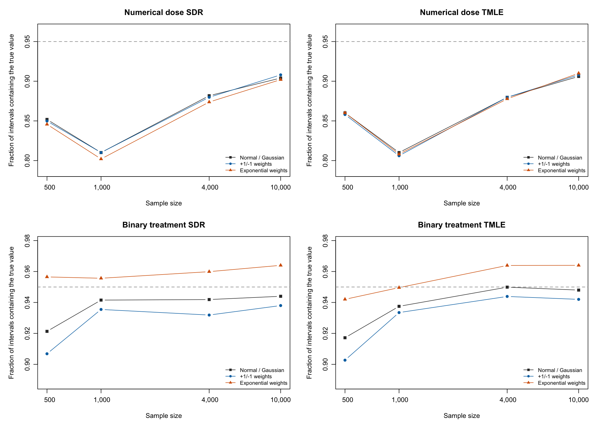

# Multiplier bootstrap using the existing simulation output

**The full study is complete:** 4000 saved dataset checkpoints. Each setting has 500 to 500 completed datasets out of the planned 500. No original simulation or nuisance fit was rerun.

The original fit failures are retained: 15832 returned outcome estimates out of 16000 possible. An estimator that failed does not contribute an interval or count as a bootstrap success; the tables show its missing-fit denominator. All 4000 checkpoints passed integrity checks, and all returned outcome gradients passed reconstruction checks. A failed original fit has no gradient to reconstruct.

## Main findings

Gaussian multipliers reproduce all original pointwise intervals exactly. This is the analytic conditional Gaussian identity, not a failure to run the bootstrap.

For numerical dose at t=3, switching to the non-Gaussian multipliers changes coverage by at most 0.81 percentage points in either direction. It does not resolve undercoverage. The candidate nuisance functions, estimates and conditional variances are held fixed; only bootstrap quantiles change.

For binary treatment at t=3, exponential multipliers improve observed coverage by 1.2 to 3.5 percentage points across the available estimator/sample-size combinations. This is a useful distributional-shape improvement in that example, rather than a general repair for the numerical-dose bias. Every prespecified multiplier and all failures are reported; no package default is changed.

## What was done

The original checkpoints did not retain individual influence-function vectors. They did retain the predictions of every fitted nuisance function on the complete finite support, the original data seed, and all sample splits. The original observations were regenerated from that seed, and the saved predictions were evaluated by support lookup in the original validation folds. No regression, bridge, adjoint, penalty or ensemble was refitted. Reconstructed means and SEs were checked against each saved estimate and SE before bootstrap draws were accepted. Small numerical differences from prediction batches are recorded in the audit in units of the sampling SE, with a maximum permitted relative discrepancy of 0.00001.

For each dataset, the estimated influence function is centered at its sample mean. Independent person-level multipliers have mean zero and variance one. The bootstrap perturbation is the average of multiplier times centered influence function, with a square-root n/(n-1) correction to use the same finite-sample variance convention as the original sample-SD-based SE. The same person multipliers are used for SDR, TMLE and both outcome times. Equal score vectors are grouped within an original outer fold and observed data category: sums of +1/-1 multipliers are generated by binomial draws, and sums of exponential weights by Gamma draws. These are exact distributions of the independent person-level multiplier sums, not a resampling of groups as single observations.

Three prespecified choices are compared. Gaussian weights are standard normal. Their conditional scalar distribution is exactly normal with variance equal to the original reported SE squared, so their pointwise intervals are exactly the original normal intervals; simulation of that known distribution would add only Monte Carlo noise. The +1/-1 weights are equally likely and use a symmetric 95% absolute-perturbation quantile. Exponential weights have rate one and are shifted down by one to have mean zero; the interval uses the 2.5% and 97.5% perturbation quantiles in reversed order around the original estimate. Thus the exponential interval can be asymmetric.

Each non-Gaussian choice uses 9,999 draws per dataset. No estimated mean bias is subtracted, no true variance is substituted, and the known parameter is used only to count interval coverage. The quantiles and intervals do not depend on that truth. Random streams are fixed separately by the original dataset seed and multiplier type, so worker order does not change results.

The [Gaussian multiplier method of Chernozhukov, Chetverikov and Kato](https://arxiv.org/abs/1212.6906) motivates the fixed-influence-function perturbation. The scalar Gaussian identity above also follows directly from the variance of a linear combination of independent normal variables. The simultaneous Gaussian bands for the outcome curve were already computed in the original study; this comparison concerns pointwise intervals, particularly at t=3.

## Numerical dose: outcome at t=3

| n | Estimator | Returned | Failed | Pending | Normal / Gaussian | +1/-1 weights | Exponential weights |
| --- | --- | --- | --- | --- | --- | --- | --- |
|   500 | SDR | 486 | 14 | 0 | 85.2% | 85.0% | 84.6% |
|   500 | TMLE | 486 | 14 | 0 | 86.0% | 85.8% | 86.0% |
|  1000 | SDR | 495 |  5 | 0 | 81.0% | 81.0% | 80.2% |
|  1000 | TMLE | 495 |  5 | 0 | 81.0% | 80.6% | 80.8% |
|  4000 | SDR | 499 |  1 | 0 | 88.2% | 88.0% | 87.4% |
|  4000 | TMLE | 499 |  1 | 0 | 88.0% | 88.0% | 87.8% |
| 10000 | SDR | 500 |  0 | 0 | 90.4% | 90.8% | 90.2% |
| 10000 | TMLE | 500 |  0 | 0 | 90.6% | 90.8% | 91.0% |

## Binary treatment: outcome at t=3

| n | Estimator | Returned | Failed | Pending | Normal / Gaussian | +1/-1 weights | Exponential weights |
| --- | --- | --- | --- | --- | --- | --- | --- |
|   500 | SDR | 483 | 17 | 0 | 92.1% | 90.7% | 95.7% |
|   500 | TMLE | 483 | 17 | 0 | 91.7% | 90.3% | 94.2% |
|  1000 | SDR | 496 |  4 | 0 | 94.2% | 93.5% | 95.6% |
|  1000 | TMLE | 496 |  4 | 0 | 93.8% | 93.3% | 95.0% |
|  4000 | SDR | 499 |  1 | 0 | 94.2% | 93.2% | 96.0% |
|  4000 | TMLE | 499 |  1 | 0 | 95.0% | 94.4% | 96.4% |
| 10000 | SDR | 500 |  0 | 0 | 94.4% | 93.8% | 96.4% |
| 10000 | TMLE | 500 |  0 | 0 | 94.8% | 94.2% | 96.4% |

## Numerical dose: outcome at t=2

| n | Estimator | Returned | Failed | Pending | Normal / Gaussian | +1/-1 weights | Exponential weights |
| --- | --- | --- | --- | --- | --- | --- | --- |
|   500 | SDR | 486 | 14 | 0 | 93.6% | 93.4% | 93.6% |
|   500 | TMLE | 486 | 14 | 0 | 90.7% | 90.7% | 91.2% |
|  1000 | SDR | 495 |  5 | 0 | 96.4% | 96.0% | 96.2% |
|  1000 | TMLE | 495 |  5 | 0 | 96.4% | 96.4% | 96.6% |
|  4000 | SDR | 499 |  1 | 0 | 94.2% | 94.2% | 94.0% |
|  4000 | TMLE | 499 |  1 | 0 | 94.2% | 94.6% | 94.4% |
| 10000 | SDR | 500 |  0 | 0 | 93.6% | 93.6% | 93.4% |
| 10000 | TMLE | 500 |  0 | 0 | 93.8% | 93.8% | 93.6% |

## Binary treatment: outcome at t=2

| n | Estimator | Returned | Failed | Pending | Normal / Gaussian | +1/-1 weights | Exponential weights |
| --- | --- | --- | --- | --- | --- | --- | --- |
|   500 | SDR | 483 | 17 | 0 | 94.2% | 94.2% | 93.4% |
|   500 | TMLE | 483 | 17 | 0 | 93.2% | 93.0% | 93.0% |
|  1000 | SDR | 496 |  4 | 0 | 94.0% | 94.0% | 92.5% |
|  1000 | TMLE | 496 |  4 | 0 | 94.0% | 94.0% | 93.8% |
|  4000 | SDR | 499 |  1 | 0 | 92.0% | 91.8% | 91.4% |
|  4000 | TMLE | 499 |  1 | 0 | 91.6% | 91.4% | 91.0% |
| 10000 | SDR | 500 |  0 | 0 | 93.4% | 93.4% | 93.0% |
| 10000 | TMLE | 500 |  0 | 0 | 94.0% | 93.8% | 93.6% |

## Comparison with Monte Carlo SD at t=3

These are the same diagnostic calculations requested previously, now evaluated on the full completed snapshot. They use the SD across returned estimates, without replacing it by the standard error of the Monte Carlo average. This is a separate evaluation calculation; that SD is not used for any of the multiplier intervals.

| n | Estimator | Returned | Original intervals | Monte Carlo SD | Monte Carlo SD, mean bias removed | Estimated / Monte Carlo variance |
| --- | --- | --- | --- | --- | --- | --- |
|   500 | SDR | 486 | 85.2% | 93.0% | 94.9% | 0.985 |
|   500 | TMLE | 486 | 86.0% | 93.2% | 94.2% | 1.015 |
|  1000 | SDR | 495 | 81.0% | 85.9% | 96.0% | 0.847 |
|  1000 | TMLE | 495 | 81.0% | 86.1% | 96.2% | 0.835 |
|  4000 | SDR | 499 | 88.2% | 92.2% | 95.0% | 0.952 |
|  4000 | TMLE | 499 | 88.0% | 92.0% | 95.0% | 1.001 |
| 10000 | SDR | 500 | 90.4% | 93.6% | 94.0% | 0.867 |
| 10000 | TMLE | 500 | 90.6% | 93.8% | 94.0% | 0.887 |

## Interpretation and numerical precision

All multiplier choices have the same conditional variance, up to numerical prediction roundoff; they change the distributional shape and quantiles, not the nuisance fits or their bias. A fixed-influence-function multiplier bootstrap cannot estimate a systematic bias from nuisance estimation, and it does not refit those nuisance functions to capture additional variation beyond the estimated influence function. These limitations are relevant to the preceding Monte Carlo variance diagnosis.

Small coverage differences should be assessed relative to approximately 500 Monte Carlo datasets and finite bootstrap-quantile accuracy. The complete summary gives the number of intervals newly covering or newly missing the truth relative to the original interval, paired simulation standard errors for the coverage changes, interval-length ratios, and original bias and scaled MSE. Numerical differences of a few intervals are not evidence that a multiplier choice fixes the estimator. No multiplier is selected or installed as a package default based on this comparison.

[All intervals](intervals.csv), [complete summary](summary.csv), [reconstruction audit](reconstruction-audit.csv), [original fit failures](original-fit-errors.csv), [postprocessing failures](postprocessing-errors.csv), [runtime](runtime.json), [bootstrap configuration](configuration.json), [original checkpoint hashes](checkpoint-manifest.json), and [artifact provenance](artifact-provenance.json).
