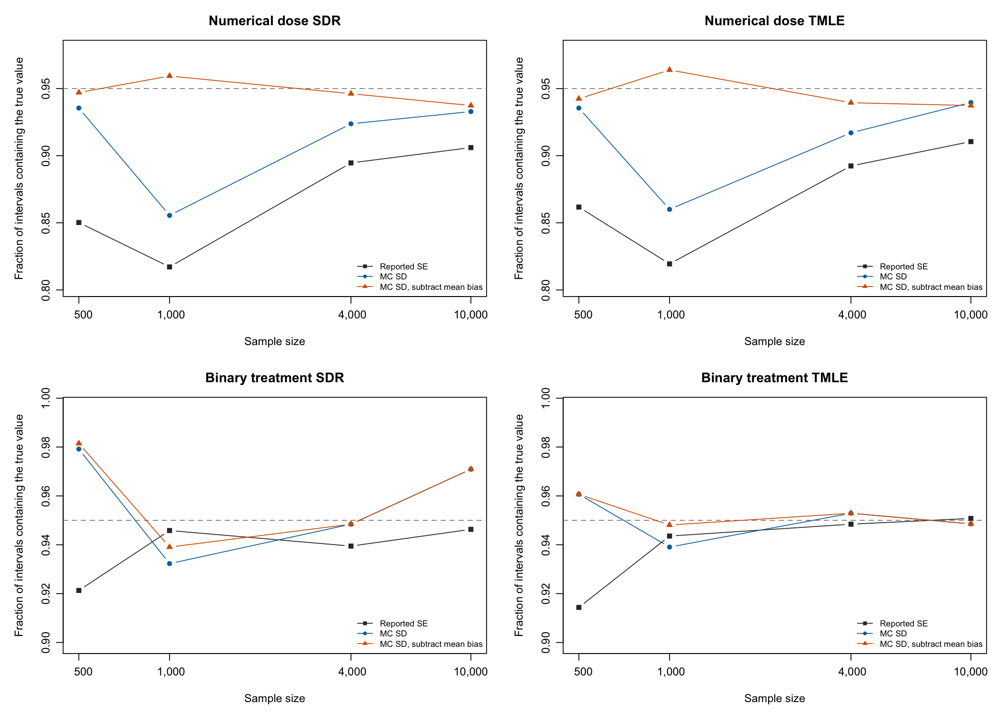

# Does Monte Carlo variance explain undercoverage at t=3?

**PRELIMINARY: 3576 of 4,000 dataset checkpoints; 38 datasets have recorded estimator errors.** Snapshot analyzed 2026-10-16 09:06:06 EDT.

Each table uses every returned t=3 estimate in its setting. Failed estimators are retained in errors.csv and excluded from variance and coverage calculations, because they do not return an interval. Pending datasets are not included. The estimator, nuisance fits, penalties, splits and seeds are unchanged. No new datasets are fitted for this analysis.

## Calculation

Within each treatment setting, sample size and estimator, compute the sample variance of the estimates across Monte Carlo runs, centered at their average estimate, with divisor equal to the number of returned estimates minus one. Its square root is the Monte Carlo SD. This approximates the estimator's true sampling SD; it is not the root mean squared error, and it is not divided by the square root of the number of simulation runs.

For each saved estimate, replace its reported SE by this common Monte Carlo SD and recompute the interval as the estimate plus or minus 1.959964 times that SD. The estimate itself is not shifted. MC SD coverage therefore preserves the original mean bias. MC SD, subtract mean bias additionally subtracts the across-run mean estimation error before forming the interval, separating the effect of mean bias from interval width. These are simulation diagnostics, not new usable estimators or proposed confidence intervals.

The variance ratio is mean(reported SE squared) divided by the Monte Carlo variance. A ratio below one indicates variance underestimation on average; a ratio above one indicates overestimation on average. Because the same completed runs estimate the variance and evaluate coverage, uncertainty calculations resample runs and re-estimate both quantities. All observations, including extreme estimates, are retained.

## Numerical dose

| n | Estimator | Returned | Failed | Pending | Reported SE coverage | MC SD coverage | MC SD, subtract mean bias | VarianceRatio | Bias / MC SD |
| --- | --- | --- | --- | --- | --- | --- | --- | --- | --- |
|   500 | SDR | 434 | 13 | 53 | 85.0% | 93.5% | 94.7% | 0.977 | -0.599 |
|   500 | TMLE | 434 | 13 | 53 | 86.2% | 93.5% | 94.2% | 1.002 | -0.605 |
|  1000 | SDR | 443 |  4 | 53 | 81.7% | 85.6% | 95.9% | 0.861 | -0.817 |
|  1000 | TMLE | 443 |  4 | 53 | 81.9% | 86.0% | 96.4% | 0.848 | -0.815 |
|  4000 | SDR | 446 |  1 | 53 | 89.5% | 92.4% | 94.6% | 0.991 | -0.480 |
|  4000 | TMLE | 446 |  1 | 53 | 89.2% | 91.7% | 93.9% | 1.047 | -0.536 |
| 10000 | SDR | 447 |  0 | 53 | 90.6% | 93.3% | 93.7% | 0.878 | -0.387 |
| 10000 | TMLE | 447 |  0 | 53 | 91.1% | 94.0% | 93.7% | 0.901 | -0.430 |

## Binary treatment

| n | Estimator | Returned | Failed | Pending | Reported SE coverage | MC SD coverage | MC SD, subtract mean bias | VarianceRatio | Bias / MC SD |
| --- | --- | --- | --- | --- | --- | --- | --- | --- | --- |
|   500 | SDR | 432 | 15 | 53 | 92.1% | 97.9% | 98.1% | 0.563 | 0.042 |
|   500 | TMLE | 432 | 15 | 53 | 91.4% | 96.1% | 96.1% | 1.343 | 0.010 |
|  1000 | SDR | 443 |  4 | 53 | 94.6% | 93.2% | 93.9% | 0.987 | 0.126 |
|  1000 | TMLE | 443 |  4 | 53 | 94.4% | 93.9% | 94.8% | 1.442 | 0.095 |
|  4000 | SDR | 446 |  1 | 53 | 93.9% | 94.8% | 94.8% | 0.900 | 0.031 |
|  4000 | TMLE | 446 |  1 | 53 | 94.8% | 95.3% | 95.3% | 1.174 | 0.014 |
| 10000 | SDR | 447 |  0 | 53 | 94.6% | 97.1% | 97.1% | 1.049 | 0.003 |
| 10000 | TMLE | 447 |  0 | 53 | 95.1% | 94.9% | 94.9% | 1.857 | -0.011 |

## Diagnosis for the current numerical-dose results

Replacing reported SEs by the Monte Carlo SD improves coverage at every sample size, but variance estimation alone does not explain the full pattern.

- **n=1,000:** coverage increases from 81.7%/81.9% to 85.6%/86.0% (SDR/TMLE), remaining far below 95%. The mean error is about -0.82 Monte Carlo SD for both estimators. Subtracting that mean bias while using the Monte Carlo SD gives 95.9%/96.4% coverage. Average reported variances are about 14%/15% below Monte Carlo variance, so variance underestimation contributes but does not explain most of the deficit in this comparison.
- **n=4,000:** average reported variance is approximately correct: estimated/Monte Carlo ratios are 0.991/1.047. Coverage with Monte Carlo SD remains 92.4%/91.7%; subtracting mean bias raises it to 94.6%/93.9%. Subtracting mean bias while retaining the original dataset-specific SEs instead gives 94.2%/95.3%. This points to mean bias as an important contributor; a uniform variance increase is not the appropriate general explanation here.
- **n=10,000:** reported variances are about 12%/10% below Monte Carlo variance. Monte Carlo-SD coverage improves from 90.6%/91.1% to 93.3%/94.0%. Subtracting mean bias as well gives 93.7%/93.7%, adding little in this particular calculation. Both Monte Carlo-SD coverage simulation intervals include 95%; the remaining shortfall does not establish a variance-formula error or a persistent departure from nominal coverage.
- **n=500:** Monte Carlo-SD coverage improves to 93.5% for both estimators even though average estimated variance is close to Monte Carlo variance (ratios 0.977/1.002). Matching only average variance, while preserving relative dataset-specific SEs, leaves coverage at 85.3%/86.2%. Thus the gain from a common SD cannot be interpreted simply as correcting average variance underestimation; variation in interval widths across datasets, its relationship with estimation errors, and mean bias matter. Subtracting mean bias with the original SEs gives 93.8%/95.2%.

These comparisons assess separate changes to the same estimates. Their gains are not additive, and subtracting mean bias need not improve coverage monotonically in a finite, possibly asymmetric distribution. No package variance formula is changed by this diagnosis. All numbers are conditional on a fit returning successfully, with failures separately retained.

## Simulation uncertainty for the numerical-dose comparison

The intervals below are 95% bootstrap simulation intervals from 2,000 resamples of completed Monte Carlo runs; estimates and reported SEs stay paired, and bias and SD are recomputed in every resample. Coverage-change intervals account for the dependence between the two coverage calculations. They describe simulation uncertainty, not uncertainty about the causal parameter.

| n | Estimator | MC SD coverage, interval | MC SD, subtract bias, interval | Coverage change, percentage points | Estimated / MC variance, interval |
| --- | --- | --- | --- | --- | --- |
|   500 | SDR | 93.5% [91.2%, 95.2%] | 94.7% [93.1%, 95.9%] | +8.5 [+4.8, +11.8] | 0.977 [0.826, 1.162] |
|   500 | TMLE | 93.5% [91.0%, 94.9%] | 94.2% [92.9%, 95.9%] | +7.4 [+3.7, +10.1] | 1.002 [0.863, 1.173] |
|  1000 | SDR | 85.6% [82.8%, 88.5%] | 95.9% [94.4%, 97.3%] | +3.8 [+1.1, +7.9] | 0.861 [0.765, 0.977] |
|  1000 | TMLE | 86.0% [83.3%, 89.6%] | 96.4% [94.1%, 97.7%] | +4.1 [+1.6, +8.8] | 0.848 [0.730, 0.988] |
|  4000 | SDR | 92.4% [90.6%, 94.2%] | 94.6% [93.3%, 96.0%] | +2.9 [+0.0, +6.5] | 0.991 [0.863, 1.149] |
|  4000 | TMLE | 91.7% [89.7%, 93.9%] | 93.9% [92.8%, 95.7%] | +2.5 [-0.2, +5.8] | 1.047 [0.911, 1.211] |
| 10000 | SDR | 93.3% [91.7%, 95.3%] | 93.7% [92.4%, 95.3%] | +2.7 [+0.0, +6.0] | 0.878 [0.781, 1.007] |
| 10000 | TMLE | 94.0% [91.5%, 95.3%] | 93.7% [91.9%, 95.1%] | +2.9 [-0.4, +5.4] | 0.901 [0.795, 1.039] |

## Reading the comparison

If replacing SEs by the Monte Carlo SD brings coverage close to 95%, the reported interval widths contribute to undercoverage. If coverage remains low, variance estimation alone is insufficient: mean bias or a nonnormal sampling distribution can still be responsible. The bias-subtracted calculation helps distinguish those explanations. A common Monte Carlo SD also removes differences in interval widths across datasets, so a coverage change need not arise solely from average variance underestimation.

Rare large errors can inflate the Monte Carlo variance, especially for binary treatment. The complete CSV reports the largest-error shares of MSE, standardized-error quantiles, and all variance/coverage calculations. No outlier is removed. Partial completion may depend on fitting difficulty, and the sampling-variance calculation is conditional on an estimator returning successfully. Results remain preliminary until the full study and its failures are assessed.

[Complete t=3 calculations](t3-variance-diagnosis.csv), [each recomputed t=3 interval](t3-mc-intervals.csv), [all saved estimates and reported intervals](replicates.csv), [counts and errors by dataset](job_log.csv), [recorded failures](errors.csv), [complete bias/variance assessment](BIAS-VARIANCE.md), [checkpoint hashes](checkpoint-manifest.json), [artifact provenance](artifact-provenance.json), and [frozen fitting sources](source-manifest.json), and [independent numerical verification](verification.json).
