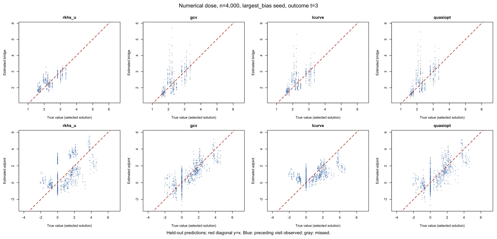
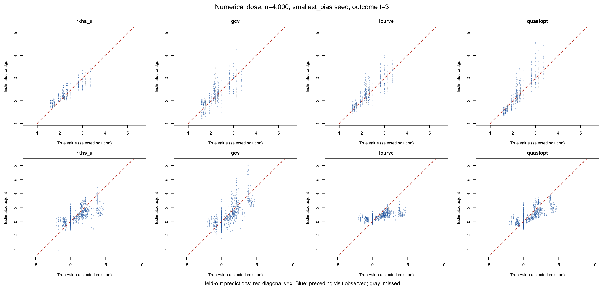
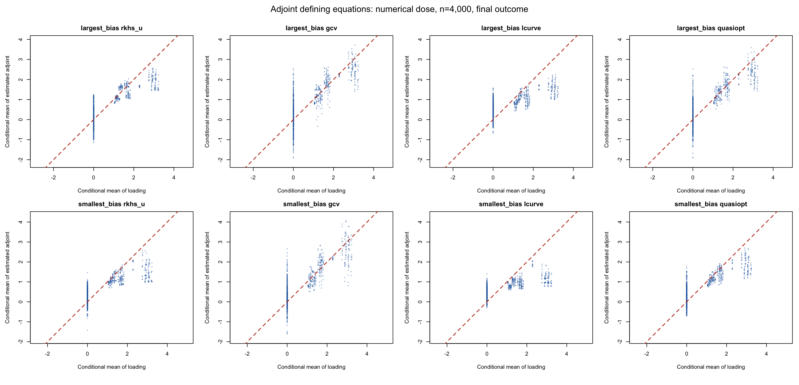

# Inverse-problem penalty selection: numerical dose, n=4,000

Completed limited diagnostic of the two previously selected numerical-dose datasets, seeds 5203041 and 5203167. Both follow-ups, three saved outer folds and three parameter-choice rules are evaluated. This is not a 200-replication study and provides no new SDR/TMLE estimates or confidence-interval coverage.

The Robins and Syrgkanis adapters are reverted on the replacement branches. The original DGP, datasets, three candidate classes, bridge inverse-expit links and unrestricted adjoints are retained. Ensemble weights still minimize the original RKHS U criterion with its existing PSD projection. Only candidate regularization selection is replaced. All three candidates now tune ridge or stopping iterations; previously only sieve had a penalty-CV grid.

GCV uses the native inverse-equation residual and the fitted sensitivity trace; L-curve selects positive residual-versus-regularization curvature; interior quasi-optimality selects a strict valley in changes of fitted functions along the logarithmic path. Boundary choices are failures, with positive grid extensions and no default-selector replacements. Missing corners or valleys can remove a candidate from the existing ensemble library. Failed attempts are retained.

Each candidate path uses only its supplied training rows. The original outer and learner folds are preserved, without the extra projection sample used in the reverted adapters. The final refit selects on its full training sample. Exact DGP treatment ratios construct the isolated adjoint loading, as in the preceding diagnostic; no regression learners are fitted. True functions are used only for evaluation. References can be nonunique, so the defining equations are also evaluated.

These parameter-choice heuristics do not directly estimate full-function MSE. Classical GCV assumes a fixed operator and white equation noise; our empirical operator is random and conditional moments can be heteroscedastic. Linked fits use local or numerical sensitivities. Candidate instrument bases and function classes are not changed by penalty selection. An individual candidate need not contain a true solution even when the library does.

## Final-outcome ensemble results

Errors integrate over the exact finite DGP population. Squared errors are averaged over available outer fits before taking the square root. Completed-fold counts disclose incomplete ensembles.

| Seed | Rule | Bridge RMSE | Bridge equation RMSE | Bridge folds | Adjoint equation RMSE | Adjoint folds |
|---|---|---:|---:|---:|---:|---:|
| 5203041 | rkhs_u | 0.25521 | 0.09104 | 3/3 | 0.44014 | 3/3 |
| 5203041 | gcv | 0.44722 | 0.11674 | 3/3 | 0.34512 | 3/3 |
| 5203041 | lcurve | 0.40286 | 0.10749 | 3/3 | 0.48655 | 3/3 |
| 5203041 | quasiopt | 0.43803 | 0.11694 | 3/3 | 0.35970 | 3/3 |
| 5203167 | rkhs_u | 0.16979 | 0.05998 | 3/3 | 0.39176 | 3/3 |
| 5203167 | gcv | 0.28619 | 0.09250 | 3/3 | 0.28197 | 3/3 |
| 5203167 | lcurve | 0.22151 | 0.07616 | 3/3 | 0.46297 | 3/3 |
| 5203167 | quasiopt | 0.23788 | 0.07945 | 3/3 | 0.36848 | 3/3 |

## Ensemble weights

| Seed | Rule | Function | Candidate | Mean weight | Completed folds |
|---|---|---|---|---:|---:|
| 5203041 | gcv | bridge | sieve_md | 0.2915 | 3/3 |
| 5203041 | gcv | bridge | landweber | 0.0000 | 3/3 |
| 5203041 | gcv | bridge | pmmr | 0.7085 | 3/3 |
| 5203041 | gcv | adjoint | sieve_md | 0.0000 | 3/3 |
| 5203041 | gcv | adjoint | landweber | 0.0000 | 3/3 |
| 5203041 | gcv | adjoint | pmmr | 1.0000 | 3/3 |
| 5203041 | rkhs_u | bridge | sieve_md | 0.3310 | 3/3 |
| 5203041 | rkhs_u | bridge | landweber | 0.3083 | 3/3 |
| 5203041 | rkhs_u | bridge | pmmr | 0.3607 | 3/3 |
| 5203041 | rkhs_u | adjoint | sieve_md | 0.2893 | 3/3 |
| 5203041 | rkhs_u | adjoint | landweber | 0.7107 | 3/3 |
| 5203041 | rkhs_u | adjoint | pmmr | 0.0000 | 3/3 |
| 5203041 | lcurve | bridge | sieve_md | 0.4384 | 3/3 |
| 5203041 | lcurve | bridge | landweber | 0.0000 | 3/3 |
| 5203041 | lcurve | bridge | pmmr | 0.5616 | 3/3 |
| 5203041 | lcurve | adjoint | sieve_md | 0.2814 | 3/3 |
| 5203041 | lcurve | adjoint | landweber | 0.7186 | 3/3 |
| 5203041 | lcurve | adjoint | pmmr | 0.0000 | 3/3 |
| 5203041 | quasiopt | bridge | sieve_md | 0.4594 | 3/3 |
| 5203041 | quasiopt | bridge | landweber | 0.0000 | 3/3 |
| 5203041 | quasiopt | bridge | pmmr | 0.5406 | 3/3 |
| 5203041 | quasiopt | adjoint | sieve_md | 0.1295 | 3/3 |
| 5203041 | quasiopt | adjoint | landweber | 0.2411 | 3/3 |
| 5203041 | quasiopt | adjoint | pmmr | 0.6295 | 3/3 |
| 5203167 | gcv | bridge | sieve_md | 0.3468 | 3/3 |
| 5203167 | gcv | bridge | landweber | 0.0000 | 3/3 |
| 5203167 | gcv | bridge | pmmr | 0.6532 | 3/3 |
| 5203167 | gcv | adjoint | sieve_md | 0.0000 | 3/3 |
| 5203167 | gcv | adjoint | landweber | 0.0000 | 3/3 |
| 5203167 | gcv | adjoint | pmmr | 1.0000 | 3/3 |
| 5203167 | rkhs_u | bridge | sieve_md | 0.3383 | 3/3 |
| 5203167 | rkhs_u | bridge | landweber | 0.3250 | 3/3 |
| 5203167 | rkhs_u | bridge | pmmr | 0.3367 | 3/3 |
| 5203167 | rkhs_u | adjoint | sieve_md | 0.5353 | 3/3 |
| 5203167 | rkhs_u | adjoint | landweber | 0.3803 | 3/3 |
| 5203167 | rkhs_u | adjoint | pmmr | 0.0844 | 3/3 |
| 5203167 | lcurve | bridge | sieve_md | 0.5516 | 3/3 |
| 5203167 | lcurve | bridge | landweber | 0.0000 | 3/3 |
| 5203167 | lcurve | bridge | pmmr | 0.4484 | 3/3 |
| 5203167 | lcurve | adjoint | sieve_md | 0.6157 | 3/3 |
| 5203167 | lcurve | adjoint | landweber | 0.3843 | 3/3 |
| 5203167 | lcurve | adjoint | pmmr | 0.0000 | 3/3 |
| 5203167 | quasiopt | bridge | sieve_md | 0.5497 | 3/3 |
| 5203167 | quasiopt | bridge | landweber | 0.0000 | 3/3 |
| 5203167 | quasiopt | bridge | pmmr | 0.4503 | 3/3 |
| 5203167 | quasiopt | adjoint | sieve_md | 0.1846 | 3/3 |
| 5203167 | quasiopt | adjoint | landweber | 0.2828 | 3/3 |
| 5203167 | quasiopt | adjoint | pmmr | 0.5326 | 3/3 |

## Interpretation

Every new rule increases bridge function and defining-equation error in both saved datasets relative to the original RKHS U penalty selection. GCV improves adjoint equation RMSE for both seeds; interior quasi-optimality gives smaller adjoint improvements. L-curve worsens adjoint equation RMSE in both. No new rule is a uniform repair.

The native bridge sieve has 163–183 observed target categories at t=3, plus fixed main effects. Its conditioning basis has 18 columns but only nine independent directions in all six final outer fits. Nine moment directions cannot distinguish all target-cell values. The penalty chooses among solutions of this restricted empirical equation and cannot add missing conditioning information. This limitation of the finite basis is distinct from nonuniqueness of the full conditional equation in the DGP; it does not invalidate the DGP assumptions. Dimensions are in operators.csv.

An exact population class check confirms that the Landweber bridge class contains the reference bridge: projecting its inverse-expit predictor onto the additive basis leaves error below 6e-14. Its exclusion by the new rules is therefore a parameter-choice failure, not bridge class misspecification.

For the loading used here, the additive adjoint Landweber class cannot solve the full population conditional equations. Even its best population projection has equation RMSE 0.48466 at t=3 (maximum conditional error 2.04832). This checks whether any member is a solution, so nonuniqueness of the reference does not explain that error. The saturated adjoint sieve class solves the equations within 2e-14. The library contains a correct class, but this individual Landweber candidate is misspecified. Candidate classes remain fixed in this penalty comparison. See [exact class checks](function-class-check.csv).

The actual PMMR adjoint feature spaces also lack a population solution at t=3. Their minimum possible equation RMSE ranges from 0.13513 to 0.36060 across the six final outer fits. All feature columns are independent in the population range check, and the residuals are stable when the numerical rank tolerance is tightened. These are lower bounds for those fixed feature spaces, independent of ridge selection. Expanding the feature class would be needed to remove that approximation error.

GCV excludes sieve in some fits and Landweber in every bridge/adjoint fit because no admissible interior choice is found. L-curve and quasi-optimality also exclude every bridge Landweber candidate. The existing ensemble handling sets failed candidates' weights to zero. These are successful mixtures of surviving candidates, rather than successful fits of all three learners. There are no outer ensemble failures.

The plots show that reducing some penalties increases scatter and extreme estimates rather than automatically restoring recovery. The new rules use the native training equation; original penalty CV used the richer held-out RKHS score. Complete paths are retained to inspect this difference.

[Largest-error GCV paths](largest_bias-t3-gcv-penalty-paths.png), [L-curve paths](largest_bias-t3-lcurve-penalty-paths.png), [quasi-optimality paths](largest_bias-t3-quasiopt-penalty-paths.png). Corresponding smallest-error paths also accompany the report.

## Failures and verification

59 outer/candidate failures are recorded. Failed paths are not reported as successful fits or replaced by another selector. Individual candidate panels may be blank when that candidate fails on all outer folds.

Maximum raw ensemble Gram replay error is 0.000e+00. Original outer exclusions and learner labels, selected positive interior penalties, prediction domains and exact population defining equations were checked. Source/data hashes and saved model fingerprints are verified.

[All function and equation errors](summary.csv), [weights](weight-summary.csv), [complete penalty paths](penalties.csv), [boundary attempts](boundaries.csv), [failures](failures.csv), [checks](checks.csv), [runtimes](runtimes.csv), and [all held-out predictions](out-of-sample-predictions.csv.gz). Model checkpoints remain local and ignored by Git.

## Primary references and implementation

[Golub, Heath and Wahba (1979)](https://doi.org/10.1080/00401706.1979.10489751), [Hansen and O'Leary (1993)](https://doi.org/10.1137/0914086), [Hansen's Regularization Tools](https://www2.imm.dtu.dk/~pcha/Regutools/RTv4manual.pdf), and [Bauer and Reiss](https://arxiv.org/abs/0710.1045).

Package branch: inverse-penalty-selection (0.3.0.9027). Simulation branch: inverse-penalty-n4000. [Implementation details](https://github.com/idiazst/cmbridge/blob/inverse-penalty-selection/INVERSE-PENALTY-SELECTION.md). Earlier adapters and results remain recoverable in Git history. Frozen full-study dependencies and results are unchanged.

Measured fitting time: 5.26 minutes on 6 local workers, 2026-10-12 14:09:05.255164 to 2026-10-12 14:14:21, for 36 fit pairs (72 ensembles). All fit processes finished.

Local unit tests passed 468 assertions. Package check had no errors or warnings, with the pre-existing prediction-closure binding NOTE. [Package commit](https://github.com/idiazst/cmbridge/commit/4d2c35668e6d09068f9242bef740ddbda1324c5f) passed [package and recovery validation](https://github.com/idiazst/cmbridge/actions/runs/38261040377).
