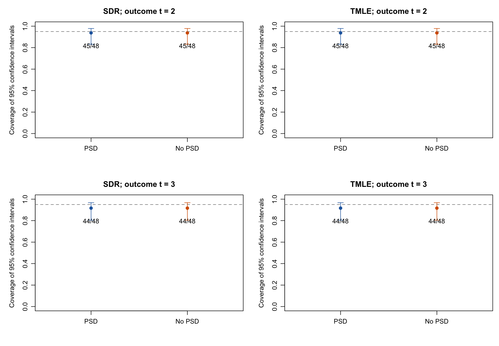
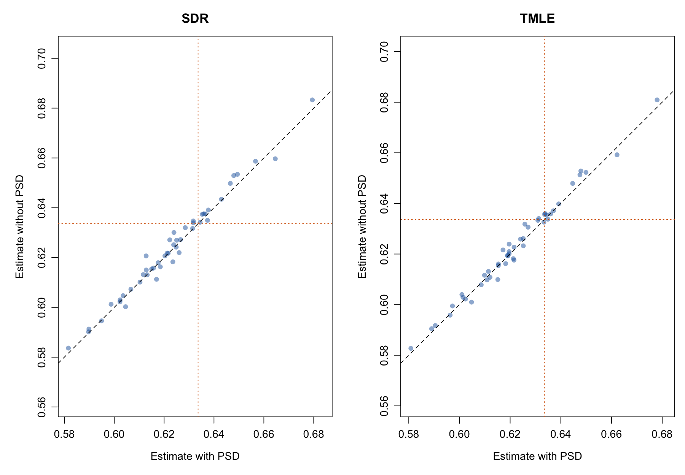
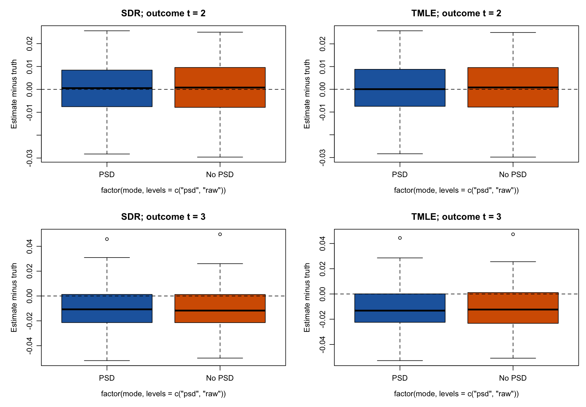
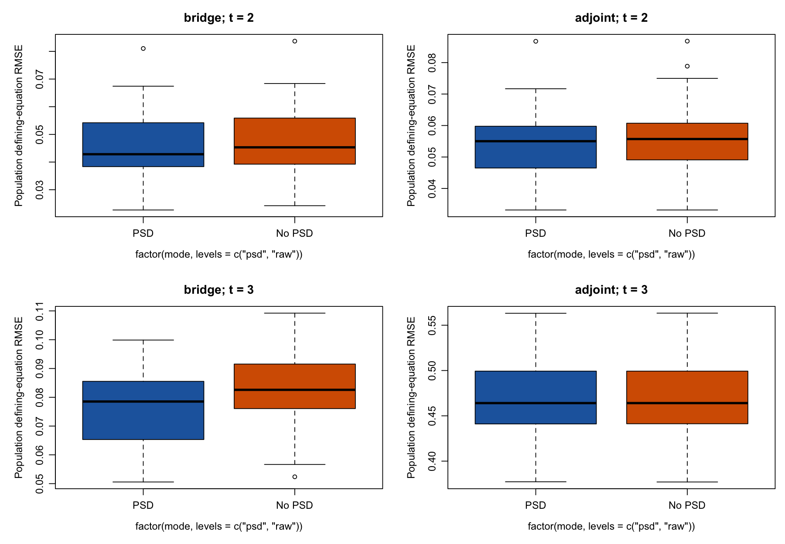
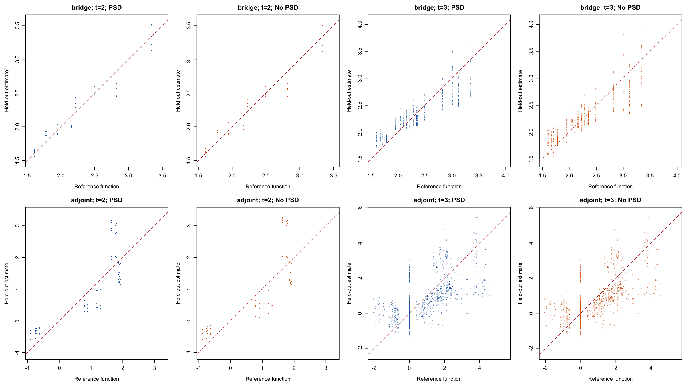
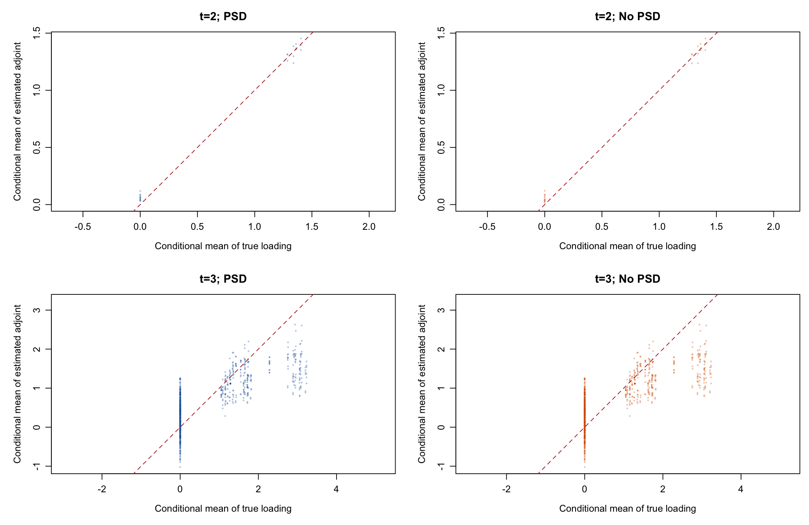
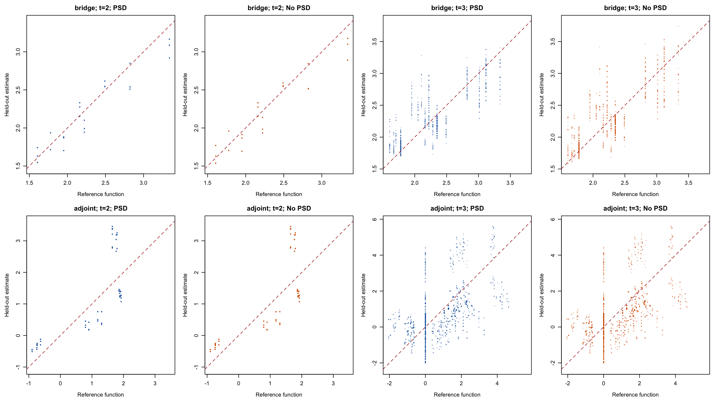
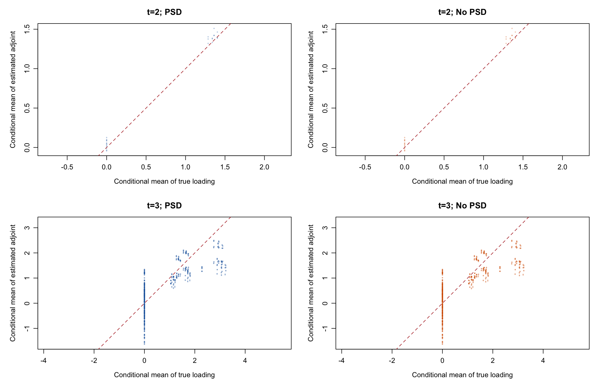

# Numerical-dose comparison: PSD versus no PSD

**Stopped at the user’s request on October 13. Preliminary results: 48 of 100 paired datasets completed (96 dataset/version checkpoints). The remaining 52 datasets are not included. No workers remain running.**

Each dataset has n = 4,000. Seeds 5203001–5203100 were specified in advance. Missingness occurs at both follow-ups. The original candidate libraries, positive penalty CV, shared splits, logistic TMLE and SDR, and one-step correction are retained. No experimental penalty-selection rules are used.

Both versions use the U-statistic. Only the ensemble Gram's PSD projection changes, including descendant bridge-response ensembles. Without projection, all simplex faces are enumerated to find the global weight minimum. Candidate penalty CV uses the original raw scalar RKHS loss in both versions. Identical descendant bridge candidates can be reused after verifying their data, library and split signatures, and are globally reweighted for the raw criterion. Sequential regressions are refitted because their bridge responses change.

## Estimates and coverage

|Outcome time|Estimator|Projection|Returned / planned|Truth|Mean estimate|Bias|Empirical SD|Mean SE|95% CI coverage|
|---|---|---|---:|---:|---:|---:|---:|---:|---:|
|2|SDR|PSD|48 / 100|0.8517|0.8521|0.0004|0.0120|0.0124|93.8%|
|2|SDR|No PSD|48 / 100|0.8517|0.8525|0.0008|0.0127|0.0130|93.8%|
|2|TMLE|PSD|48 / 100|0.8517|0.8521|0.0004|0.0121|0.0124|93.8%|
|2|TMLE|No PSD|48 / 100|0.8517|0.8525|0.0008|0.0128|0.0129|93.8%|
|3|SDR|PSD|48 / 100|0.6336|0.6231|-0.0106|0.0194|0.0215|91.7%|
|3|SDR|No PSD|48 / 100|0.6336|0.6239|-0.0097|0.0198|0.0215|91.7%|
|3|TMLE|PSD|48 / 100|0.6336|0.6221|-0.0115|0.0187|0.0214|91.7%|
|3|TMLE|No PSD|48 / 100|0.6336|0.6229|-0.0107|0.0192|0.0214|91.7%|

Coverage denominators are the 48 returned estimates in each cell; the other 52 datasets were not completed. None of these 48 pairs had an outer or final-estimator failure. Missing/failed fits are disclosed separately. At 100 replications, the Monte Carlo standard error of 95% coverage is about 2.2 percentage points. Compare versions using paired differences, not independent-proportion errors.

|Outcome time|Estimator|Paired datasets|Coverage change without PSD|Paired MC SE|Newly covered|Newly missed|
|---|---|---:|---:|---:|---:|---:|
|2|SDR|48|0.0 pp|0.0 pp|0|0|
|2|TMLE|48|0.0 pp|0.0 pp|0|0|
|3|SDR|48|0.0 pp|0.0 pp|0|0|
|3|TMLE|48|0.0 pp|0.0 pp|0|0|

## Bridge and adjoint recovery

Population conditional equations are evaluated on the exact finite DGP support with its probabilities. The adjoint loading for this evaluation uses the true treatment ratios; all fitted treatment ratios and sequential regressions are estimated. Function plots compare a specified reference solution; because solutions may be nonunique, adjoint defining-equation errors are the primary criterion.

|Outcome time|Function|Projection|Mean population equation RMSE|Mean RMSE to reference function|
|---|---|---|---:|---:|
|2|bridge|PSD|0.0457|0.1434|
|2|adjoint|PSD|0.0543|0.6538|
|3|bridge|PSD|0.0763|0.2167|
|3|adjoint|PSD|0.4653|0.8306|
|2|bridge|No PSD|0.0467|0.1473|
|2|adjoint|No PSD|0.0558|0.6949|
|3|bridge|No PSD|0.0822|0.2436|
|3|adjoint|No PSD|0.4656|0.8312|

Replication 1, seed 5203001. All held-out points and all outer fits are retained.

Replication 41, seed 5203041. All held-out points and all outer fits are retained.

## Verification, failures and runtime

48 paired datasets have identical data and shared split hashes. 28512 matched ensemble fits have identical candidate predictions, CV predictions, penalty histories, fold labels and raw Grams. 0 ensemble records have no counterpart (for example after a failed estimator).
Outer failures: 0; returned-estimator errors: 0; recorded nuisance candidate failures: 116. All attempts are retained. Failed ensembles or estimators are not replaced.
Measured fitting wall span: 3.08 hours. Total fitting time summed across workers: 24.12 hours. Median dataset/version times: PSD 1545.3 s; no PSD 252.5 s. The supervisor used eight workers. Reuse avoids repeated identical candidate fits, so these times are not a standalone optimizer benchmark.

[All estimates and confidence intervals](replicates.csv), [summary](summary.csv), [paired results](paired-summary.csv), [EIF component means](results.csv), [population diagnostics](diagnostics.csv), [recovery](recovery-summary.csv), [weights](weight-summary.csv), [candidate identity checks](paired-candidate-checks.csv), [failed estimators](errors.csv), [candidate failures](nuisance_failures.csv), [runtimes and checkpoint hashes](runtimes.csv), [fitting source hashes](source-manifest.json).

This is a limited study at one sample size. It does not establish asymptotic convergence or repair the full-study coverage. Report any observed benefit or deterioration using the actual paired results and their simulation uncertainty.
